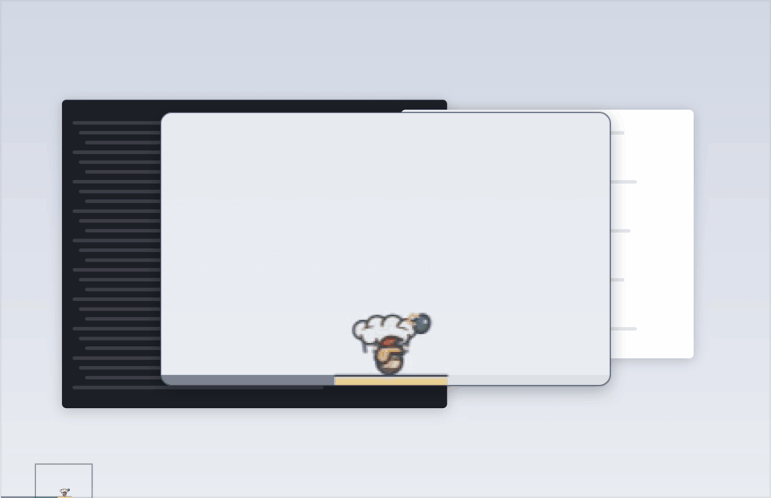

**A pomodoro that lives on the edge of your screen.** Odysseus rows, climbs, hangs and slides round your Mac's screen edge as the session passes, and the edge glows when Claude Code needs you.

### Install
1. Download `Edge-Odyssey-VERSION-arm64.zip` below (macOS 13+, Apple silicon or Intel). The filename remains for Homebrew compatibility; the app inside is universal. To verify it, also download the `.sha256` file and run `shasum -a 256 -c Edge-Odyssey-VERSION-arm64.zip.sha256`.
2. Unzip it and move **Edge Odyssey** to Applications.
3. Open it. The app is signed with a Developer ID and notarized by Apple (stapled), so macOS opens it on the first try; `spctl -a -vv -t exec "/Applications/Edge Odyssey.app"` prints `source=Notarized Developer ID`.

### Privacy
No analytics, no telemetry. The only network request is a once-a-day check of this repository's latest release, which you can turn off in *Settings*.

Made by one person with AI coding assistants. Bug reports and translation fixes are welcome in [Issues](https://github.com/s3onghyun/edge-odyssey/issues).

### What's new
