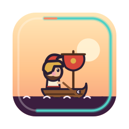
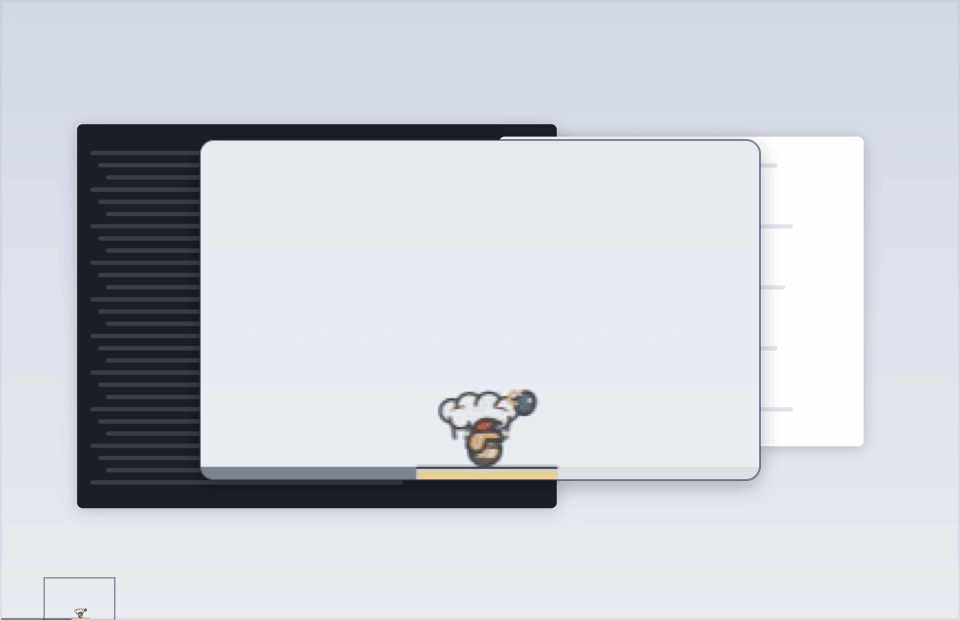
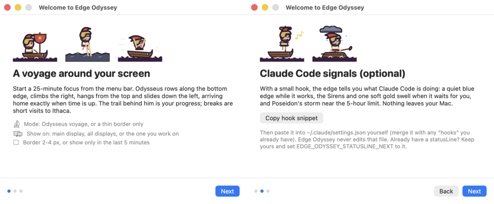
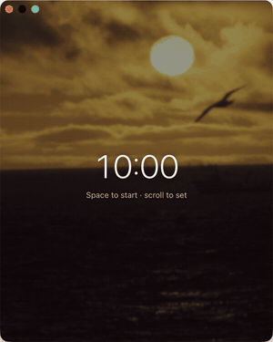
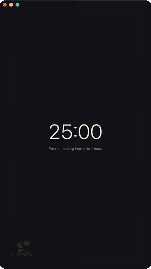
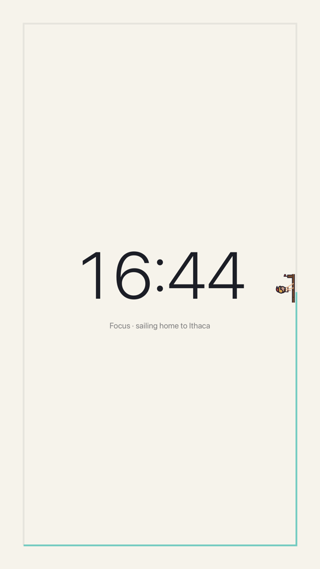
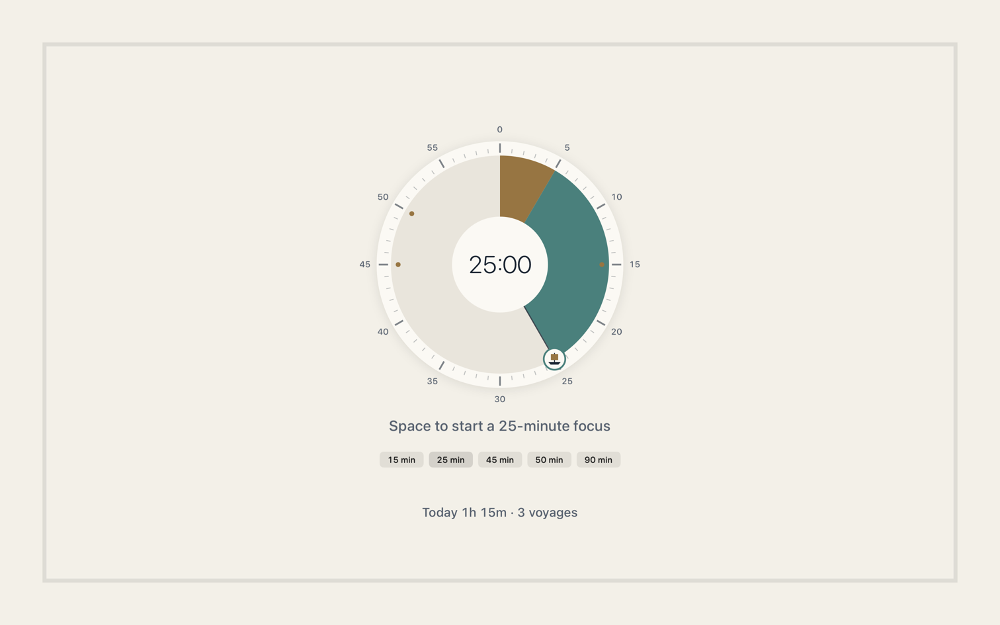
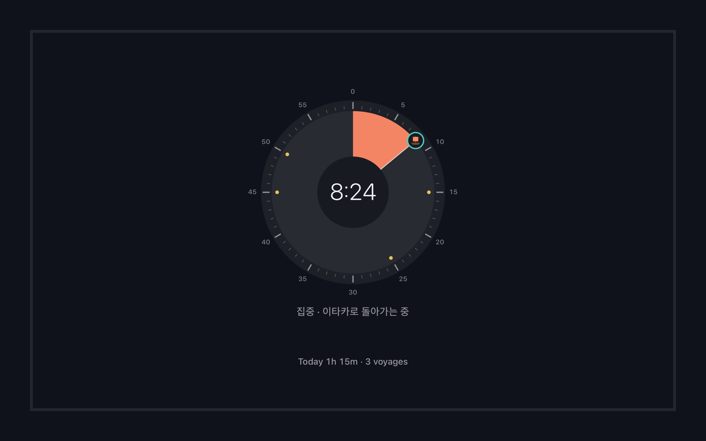
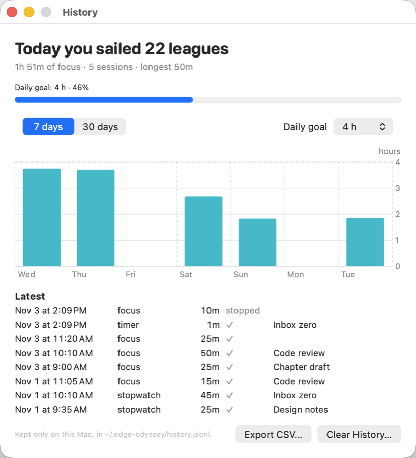
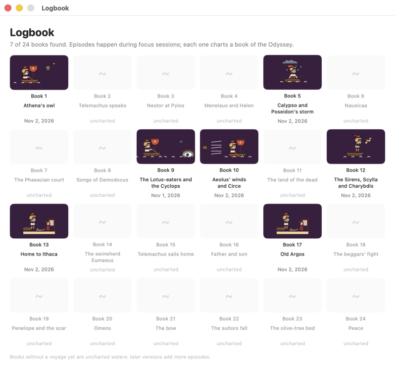

<p align="center"></p>

<h1 align="center">Edge Odyssey</h1>

<p align="center"><b>画面のふちで動くポモドーロタイマー。</b><br>
集中を始めると、小さなオデュッセウスが Mac の画面のふちを漕いで、登って、ぶら下がって、すべり降ります。
一周したらちょうど時間です。Claude Code があなたを待っているときは、ふちがそっと光ります。</p>

<p align="center">
  <a href="README.md">English</a> · <a href="README.zh-CN.md">简体中文</a> · 日本語 · <a href="README.ko.md">한국어</a>
</p>

<p align="center">
  <a href="https://github.com/s3onghyun/edge-odyssey/releases/latest"></a>
  
  <a href="LICENSE"></a>
  
</p>

<p align="center"></p>
<p align="center"><sub>25 分の一周を 75 倍速で、アプリ自身のウインドウだけを録画しました。画面全体と、オデュッセウスを追うルーペ。</sub></p>

> この日本語訳は AI の補助によるものです。修正を歓迎します（[翻訳の報告](https://github.com/s3onghyun/edge-odyssey/issues/new?template=translation.yml)）。作者が AI コーディング支援（Claude Code など）を使って作りました。絵もコードで描いたオリジナルです（[`PROVENANCE.md`](PROVENANCE.md)）。

**インストール**（macOS 13 以降、Apple シリコン）：[Releases](https://github.com/s3onghyun/edge-odyssey/releases/latest)
から ZIP をダウンロードして展開し、**Edge Odyssey** を「アプリケーション」に移します。Homebrew なら `brew install --cask s3onghyun/tap/edge-odyssey` です。まだ公証を受けていないため、
最初の起動で一度だけ許可が必要です：[初回起動](#初回起動)を見てください。表示言語は日本語、English、한국어、
简体中文で、再起動なしで切り替えられます（[言語](#言語)）。

- **ふちのポモドーロ。** 集中 25 分、休憩 5 分、4 回目の休憩は長めです。オデュッセウスがふちのどこにいるかが、
  そのセッションの経過です（一定の速さで進むので、半周なら半分経過）。通った跡が進捗バーで、時間ちょうどに家に着きます。
- **辺ごとの動き。** 下辺では漕ぎ、右辺ではつかんで引き上げながら登り（崖、オリーブの木、マスト）、上辺では
  ぶら下がって揺れたりジップラインに乗ったり、左辺では滝をすべり降り、着地でぺしゃっとつぶれます。見た目だけの
  違いです。*モード › 速度：物理的* を選ぶと登りは遅く、すべりは速くなり、位置は時間を表さなくなります。
- **『オデュッセイア』のエピソード。** キュクロプス、アイオロスの風の袋、キルケーの子豚、カリュブディス、
  アテナのフクロウが周回ごとに訪れ、全 24 巻の航海日誌を埋めていきます。
- **Claude Code のサイン（任意）。** 作業中は静かな青いふち、あなたを待っているときはセイレーンと一度だけの
  金色のうねり、5 時間の使用上限が近いとポセイドンの嵐。
- **集中モード。** 時間を真ん中で見たいときに：Control-Option-Command-F で落ち着いた全画面表示を開きます。
  中央にタイムタイマー風のダイヤル（スクロール、ドラッグ、プリセットで設定）、そのまわりに時間とともに満ちる
  トラック、その上を 3 倍の大きさのオデュッセウスが航海します。背景は暗めにした海、海岸、軌道から見たエーゲ海、
  夜空のパブリックドメイン写真（自分の写真も使えます）。サブモニターや縦置きモニターに向いています。
- **ポモドーロ、タイマー、ストップウォッチ。** 集中と休憩のセッションのほかに、任意の長さの普通のカウントダウン
  （1 分から 1 時間のプリセット）とストップウォッチがあります。時間の上でスクロールすると変わります。
  1 目盛り 1 分、Shift で 5 分、Option で 10 秒。
- **集中の記録。** 集中、タイマー、ストップウォッチを使うたびに Mac に記録します。今日の合計はメニューと集中モードに
  （「今日は 22 リーグ航海」）、毎日の目標と比べる 7 日 / 30 日のグラフと CSV 書き出しは記録ウインドウにあります。
- **じゃまをしない。** 2〜4 px のふちで、クリックは素通り。全画面アプリの中や画面の共有・収録中は隠れ、
  Control-Option-Command-H でいつでも隠せます。
- **なめらかで軽い。** 動きはすべて macOS のレンダーサーバーで動き、アプリは角と状態の変化のときだけ起きます
  （CPU 約 0.1%）。

## インストール

Edge Odyssey は Apple シリコンまたは Intel Mac の macOS 13 以降が必要です。[最新リリース](https://github.com/s3onghyun/edge-odyssey/releases/latest)
から `Edge-Odyssey-<version>-arm64.zip` と対になる `.sha256` ファイルをダウンロードしてください。
Homebrew との互換性のためファイル名はそのままですが、中のアプリは両方の Mac で動く universal ビルドです。

インストールの前にダウンロードを確認します。

```sh
cd ~/Downloads
shasum -a 256 -c Edge-Odyssey-<version>-arm64.zip.sha256
ditto -x -k "Edge-Odyssey-<version>-arm64.zip" .
mv "Edge Odyssey.app" /Applications/
```

### Homebrew

```sh
brew install --cask s3onghyun/tap/edge-odyssey
```

`brew upgrade --cask edge-odyssey` で更新します。初回起動時の許可はこの場合も一度必要です（下記）。
Homebrew 7 以降は、ほかの tap の cask を信頼（trust）するまで読み込みません。上のようにフルネームで
インストールすると、この cask だけが自動で信頼されます。インストール前に `brew info --cask s3onghyun/tap/edge-odyssey`
で確かめたいときは、先に `brew trust --cask s3onghyun/tap/edge-odyssey` を実行してください。

### 初回起動

アプリは ad-hoc 署名のみで、**まだ公証（notarization）を受けていない**ため、macOS が一度だけ確認します。

1. 「アプリケーション」から **Edge Odyssey** を開きます。macOS がアプリを確認できないと表示したら **完了** をクリックします。
2. **システム設定 → プライバシーとセキュリティ** を開き、下にスクロールして Edge Odyssey の横の
   **このまま開く** をクリックし、Touch ID かパスワードで確認します。
3. macOS 13〜14 では、代わりに「アプリケーション」でアプリを Control-クリックして **開く** を選んでもかまいません
   （macOS 15 以降ではこの方法はありません）。

先にコードを確かめたい場合は、自分でビルドできます（下記）。公証は今後のリリースで追加する予定です。

### ソースからビルド

Xcode Command Line Tools（`xcode-select --install`）だけで足ります。Xcode プロジェクトは不要です。

```sh
git clone https://github.com/s3onghyun/edge-odyssey.git && cd edge-odyssey
./build.sh                                   # -> build/Edge Odyssey.app
cp -R "build/Edge Odyssey.app" /Applications/
open "/Applications/Edge Odyssey.app"
```

最初の起動で 3 ページのはじめにガイドが開きます。そのあと Edge Odyssey はメニューバーにいます（点線の円。
時計が動いている間は小さなリングになり、集中中は満ちていき、最後の 5 分は真鍮色になり、休憩中は減っていきます）。

<p align="center"></p>

## メニュー

| 項目 | 内容 |
|---|---|
| 集中を開始 / 一時停止 / 再開 / スキップ / 停止 | タイマー。メニューバーは秒までカウントダウンします（`12:50`）。その上でスクロールすると時間が変わります（下記）。集中のあと：*休憩を始める*、*あと 5 分* または *終了する*（下記） |
| タイマー | **ポモドーロ**、**カウントダウンタイマー**、**ストップウォッチ**（下記）。カウントダウンの長さ（1、3、5、10、15、30、60 分またはカスタム）、集中 15/25/45/50/90 分またはカスタム（1〜240）、休憩 5/10/15 分またはカスタム（1〜60）、2〜6 セッションごとの長い休憩（15 分）、時間になったときの動き（下記）。任意の1日セッション目標（なし、4、6、8、または 1〜24 のカスタム）を設定できます。完了した集中はメニューと集中モードのフッターに `n/N` と表示され、現地時間の午前0時（または *今日の回数をリセット*）にリセットされます。目標に達すると通知し、次の集中の自動開始を止めます。新しい長さは次のセッションから |
| 集中モード | どこからでも Control-Option-Command-F：全画面の集中表示（下記）。もう一度で閉じる |
| 集中モードの表示先 | ディスプレイが複数あるとき：集中モードを開くディスプレイ（記憶されます） |
| 集中モードの背景 | オフ、セッションごとに別の写真（デフォルト）、1 枚に固定、または **自分のフォルダ**。ゆっくり動かすかどうか |
| モード | オデュッセウスの航海（ふち + 旅人）または細いふちだけ。速度：一定（デフォルト）または物理的 |
| キャラクター | オデュッセウス（デフォルト）または航海する開発者：ヘッドホンをしてノート PC を持った今どきの開発者が、小さなヨットでターミナルの海を渡り、画面のふちを一周します。キュクロプスや風の袋などオデュッセイアのエピソードはオデュッセウスだけに出ます |
| 表示先 | メインディスプレイ、すべてのディスプレイ（作業中のディスプレイにオデュッセウスがついてきます）、自分を追う、または名前で 1 台 |
| 枠 | 2、3、4 px |
| 最後の5分だけ表示 | 集中セッションの終わりまでふちを空けておきます（Claude Code の呼び出しは表示されます） |
| 記録… | 今日の集中、毎日の目標と比べる 7/30 日のグラフ、最近の記録、CSV 書き出し、消去（下記）。メニューの見出しの下の行に今日の合計 |
| このセッションにラベルを付ける… | 記録に残る 1 行のメモ（開始前なら次のセッション用） |
| 航海日誌… | 集めた『オデュッセイア』の 24 巻 |
| 設定…（⌘,） | このメニューのすべてのオプションをまとめたウインドウ（タイマー、時間になったら、画面表示、集中モード、一般）。開いたままなので続けていくつも変えられ、変更はすぐに反映されます |
| 一般 | **言語**（下記）、Claude Code のサイン、ゲーム・動画・SNS アプリが前面にあるときは居眠り、共有中は隠す、秒でカウントダウン（オフにすると `13m` のように分単位）、**1日1回アップデートを確認** と *今すぐ確認*（下記）、**ログイン時に起動**（オンにするまでオフ）、はじめにガイド |
| 今すぐ隠す | どこからでも Control-Option-Command-H |

設定は次の起動でも保たれます。

### 言語

*設定 › 言語*：システム（デフォルト）、English、한국어、日本語、简体中文。変更はすぐに、メニュー、開いている
ウインドウ、集中モード、通知に反映され、再起動は要りません。*システム* は優先する言語（システム設定 › 一般 ›
言語と地域）のうちアプリが持つ最初のものを選ぶので、`Français, 日本語` なら日本語になります。繁体字中国語は
簡体字で表示されず、次の言語に進みます。Edge Odyssey は *言語と地域 › アプリケーション* にも表示され、アプリごとに
選べます。日付、曜日、時間の長さは選んだ言語に従います（`2h 15m`、`2시간 15분`、`2時間15分`、`2小时15分`）。

日本語と中国語の訳は AI の補助によるもので、修正を歓迎します。アプリのすべての文字列は `L.t(en, ko, ja, zh)`
の呼び出し 1 つで、訳が抜けている、空、文字の種類が違う、英語の文字列がそのまま UI に渡される、のどれかがあると
`./test.sh` が失敗します。

### アップデート

1 日に 1 回、アプリは GitHub に最新リリースを問い合わせます：
`api.github.com/repos/s3onghyun/edge-odyssey/releases/latest` への HTTPS GET 1 回で、送るのは
`User-Agent: EdgeOdyssey/<version>`、`Accept`、固定の `Accept-Language: en` だけ。Cookie もキャッシュも使いません。
失敗したら翌日まで待ちます。新しいバージョンが出ていると、メニューの一番上に
**Edge Odyssey <version> が出ました：リリースページ…** と **このバージョンをスキップ** が出て、そのバージョンについて
通知が 1 回届きます。アプリが自分で何かをダウンロードしたりインストールしたりすることはありません。リリースページから
新しい ZIP をダウンロードし、`.sha256` を確認して、[インストール](#インストール)のとおりにアプリを置き換えてください。
*設定 › 1日1回アップデートを確認* でオフに、*今すぐ確認* ですぐに問い合わせます。

### 時間になったら

- **集中セッションの終わり：** オデュッセウスは時間ちょうどに左下の角の家に着き、イタケに上陸します（長い休憩なら
  カリュプソの島）。月桂樹の金色の波がふちを 2 周し、港から波紋ときらめきが広がります。そのあとふちは**金色のまま、
  メニューバーには経過時間を数える金色の `⚓ 到着 +0:42` が出て**、あなたが選ぶまで待ちます。クリックすると
  メニューが開き、何が起きたかの 1 行と、大きな文字で *☕ 休憩を始める*（時計が止まります。集中モードではスペース）、
  *あと 5 分集中*（S）、*終了する* が並びます。最初の到着では、同じことを説明する吹き出しがバッジの下に一度だけ出ます。
  答えないと 3 分後に休憩が自動で始まり（*タイマー › 到着後に応答がなければ*：1、3、5、10 分、または待ち続ける）、
  超過は 1 時間を超えません。そのあと時計は待機に戻ります。macOS の通知は「集中完了。5 分の休憩を始めるとタイマーが
  止まります（3 分後に自動で始まります）。」と出て、**休憩を始める** と **+5 分** のボタンが付きます（デフォルトでオン。
  最初の 1 回は許可を求めます）。到着するとき、短いハープのフレーズが小さな音量で鳴ります（*タイマー › サウンド*）。
  *タイマー › 集中が終わったら休憩を自動で始める* をオンにすると以前の動き：休憩がすぐに始まります。
- 金色には 2 つの意味があり、混ぜません。錨と一緒の月桂樹の金（`#E8C35A`）は*着いた*、もっと暖かい金色のうねりは
  *Claude Code があなたを待っている*。
- **休憩の終わり：** ふちが消え、「休憩おわり」の通知が出て、タイマーは次の集中をメニューから始めるのを**待ちます**。
  自動で始めたいときは *タイマー › 休憩のあと次の集中を始める* をオンに。サウンドがオンなら、低いハープの音が
  ふたたび船出の時を知らせます。
- *タイマー › サウンド*：**ハープ**（デフォルト。このアプリのために書いた 2 つの短いフレーズ）、**ガラス**（macOS の
  システムサウンド）、**オフ**、そして音量は小（デフォルト）か中。選ぶと 1 回鳴ります。はじめにガイドにも同じ切り替えと
  *試聴* ボタンがあります。サウンドがオフのときは、通知がシステムの通知音を鳴らします（鳴るのは 1 つだけ）。
- *タイマー › ダイヤル音*：ダイヤルを 1 分動かすごとにコードで合成した小さな機械音が鳴り、15、25、45、50 分の
  止まり位置では少し重くなります。終了音と同じ音量で、デフォルトではオン。静かに合わせたいときはここでオフにできます。
- 通知は「時間制限付き」で、macOS の集中モード / おやすみモードに従います。許可していない集中モードでは届きません。

### タイマーとストップウォッチ

<p align="center"></p>
<p align="center"><sub>（スクロールホイールのように）少しずつ合わせたカウントダウンを、夕日の写真の集中モードで 40 倍速で。</sub></p>

*タイマー* でメニューバーと集中モードの時計の種類を選びます。

- **ポモドーロ**（デフォルト）：集中、そのあと休憩、何回かごとに長い休憩。
- **カウントダウンタイマー**：10 秒から 24 時間まで、任意の長さのカウントダウン 1 回。プリセット、*カスタム…*
  （分なら `10`、`1:30`、`1:15:00`）、またはスクロールで。オデュッセウスはその長さでふちを一周します。0:00 になると
  ふちが金色に光り、集中の終わりと同じ音と通知が来て、彼はイタケで少し休み、タイマーは次に備えます。休憩は続きません。
- **ストップウォッチ**：止めるまで 0:00 から数え上げます。オデュッセウスは 1 時間でふちを一周し、次の周に入ります。
  何も減っていかないので、跡はティールのままです。

モードを切り替えると動いているものは止まります。**時間の変え方：** メニューバーの時間の上、または集中モードの
どこででもスクロール（マウスホイールかトラックパッド。上で増やし、下で減らす）、または集中モードで矢印キー
（上/右で増やし、下/左で減らす）。1 ステップは 1 分、**Shift** で 5 分、**Option** で 10 秒。集中モードでは
ダイヤルのまわりをドラッグしたり、ダイヤルの一点をクリックしたり、下のプリセットをクリックしたりもできます。
何も動いていないときは次のセッションの長さを設定して記憶し（ポモドーロの集中の長さは分単位のまま）、動いている
ときはそのセッションの残りだけを変えます。ダイヤルは 15、25、45、50 分で止まります：ホイールは 2 目盛りそこに留まり、
ドラッグは吸い付き、Force Touch トラックパッドは軽く振動します。

### 集中モード

<p align="center">
  
  
</p>
<p align="center"><sub>縦長のウインドウで 40 倍速の一周と、縦置きディスプレイでの全画面。</sub></p>
<p align="center">
  
  
</p>
<p align="center"><sub>ダイヤル。アプリ自身のビューを画面外でレンダリングしました。</sub></p>

*集中モード*（Control-Option-Command-F またはメニュー）は、前回使ったディスプレイか作業中のディスプレイに全画面で
開きます。中央は 60 分の文字盤のダイヤルで、12 時から時計回りに読みます。扇形が残り時間（海のティール。
セッションの最後の 5 分の 1 は真鍮色なので、終わりが近づくと扇形が真鍮色に変わります。休憩中はスレート）、
中心にカウントダウン。帆船が扇形のふちを示します。ドラッグしてまわすか文字盤をクリックして時間を合わせ、何も
動いていないときはダイヤルの下のプリセットも選べます。1 時間を超えると文字盤全体が埋まります。ストップウォッチは
大きな数字のままです。VoiceOver はダイヤルを調整可能なスライダーとして読み上げます。まわりのトラックが進捗バー
（ティール、終わり近くはコーラル、休憩中はラベンダーが減っていく）で、3 倍のオデュッセウスが一定の速さでまわるので、
半周なら半分経過です。エピソード、イタケ、カリュプソの島も同じ大きさで現れ、Claude Code のサイン（金色のうねり、
セイレーン、嵐）もトラックに出ます。

- **キー：** スペースで開始・一時停止・再開、S で休憩へスキップ（または休憩を終える）、Esc で終了、矢印キー・
  スクロール・ダイヤルで時間を変更（上記）。ポインタを動かすと開始/一時停止、スキップ、終了のボタンが出ます。
  ウインドウが前面にあれば、背景のクリックでも終了します。
- **どこに：** *集中モードの表示先* でディスプレイを選びます。普通の全画面ウインドウなので、操作スペースを切り替えたり、
  全画面を解除してサイズを変えたり、閉じたりできます。
- 集中モードが開いている間、そのディスプレイではふちの代わりになります（ほかのディスプレイはふちのまま）。ライトか
  ダークかは macOS に従います。
- **背景：** 荒れた海、岩の海岸、軌道から見たエーゲ海、夕日、夜空の写真が航海の後ろに敷かれ、時間が読みやすいように
  やわらげて暗くし、ゆっくり動きます。*集中モードの背景* でオフ、1 枚に固定、または **自分のフォルダ** の JPEG、PNG、
  HEIC 写真（読むのは Mac の中だけ）にできます。アプリに入っている 7 枚の写真はパブリックドメイン（NASA、NOAA、
  米国国立公園局の作品）で、それぞれの出典は [`assets/backgrounds/PROVENANCE.md`](assets/backgrounds/PROVENANCE.md) にあります。
- 画面の共有・収録中（と Control-Option-Command-H のとき）は、カウントダウン、トラック、写真が隠れて無地の背景だけになり、
  ウインドウはスクリーンショットや収録にも写りません。

### 集中の記録

<p align="center"></p>
<p align="center"><sub>記録ウインドウ（サンプルデータ）。</sub></p>

集中セッション、カウントダウンタイマー、ストップウォッチはそれぞれ終わったときに記録されます：開始、終了、モード、
時計の時間（一時停止は除く）、最後まで行ったか、任意の 1 行ラベル（*このセッションにラベルを付ける…*）。最初の 1 分で
止めたものは記録せず、休憩も記録しません。

- **今日：** 合計時間、回数、いちばん長い 1 回を、メニューの見出しの下と集中モードの下部に、航海のリーグ
  （オールで 1 時間 12 リーグ）と毎日の目標とともに表示します。
- **記録…**（メニューで Command-Y）：毎日の目標（なし、1〜8 時間。デフォルト 4）と比べる 7 日か 30 日の棒グラフ、
  最近の記録、**CSV を書き出す…**、**記録を消去…**。
- 真夜中をまたぐ記録は実際の時刻で 2 日に分けます。日付は Mac のタイムゾーンに従います。
- この Mac の `~/.edge-odyssey/history.jsonl`（1 回につき JSON 1 行）にだけ保存され、どこにも送られません。
  消去しても航海日誌には影響しません。

<p align="center"></p>

## Claude Code のサイン

はじめにガイド（または 設定 › はじめにガイド）の **フック設定をコピー** で、小さなスクリプト 2 つが
`~/.edge-odyssey/hooks/` に置かれ、設定の断片がクリップボードにコピーされます。それを自分で
`~/.claude/settings.json` に、すでにある `"hooks"` と合わせて貼り付けてください。Edge Odyssey がそのファイルを
書き換えることはありません。すでに `statusLine` がある場合はそのままにして、`EDGE_ODYSSEY_STATUSLINE_NEXT` に
元のコマンドを設定すれば両方動きます。

同じファイルは [`hooks/`](hooks/) にもあるので、手で入れてもかまいません。

フックはセッションごとに `~/.edge-odyssey/sessions/` に小さなファイルを 1 つ書きます（`working`、`waiting`、`limit`
とタイムスタンプ）。ステータスラインは `~/.edge-odyssey/usage` を書きます。アプリはそのフォルダを監視します
（ポーリングなし）。何も Mac の外に出ません。

| Claude Code のイベント | ふち |
|---|---|
| UserPromptSubmit、PreToolUse、PostToolUse | 作業中：静かな青（タイマーが動いていないときだけ） |
| Notification（許可、待機、質問、エージェントの入力待ち）、Stop | 待っている：セイレーン、金色のうねり 1 回 |
| StopFailure（rate_limit）、または 5 時間の使用量 >= 85% | 上限：琥珀色、ポセイドンの嵐 |
| SessionEnd | セッションを削除 |

## プライバシー

分析もテレメトリもありません。ネットワークを使うのは 1 日 1 回のアップデート確認（[アップデート](#アップデート)）だけで、
オフにできます。オーバーレイのウインドウはスクリーンショットや画面収録に写らず、macOS の画面収録インジケータが
点いている間（Zoom、Meet、QuickTime など）は、ふち全体（と集中モードの中身）が隠れます。ローカルのファイル：
`~/.edge-odyssey/`（フックの状態、航海日誌、集中の記録）とアプリの環境設定（`app.edgeodyssey`）。

## コマンドライン

```sh
APP="/Applications/Edge Odyssey.app/Contents/MacOS/EdgeOdyssey"
"$APP" --speed 75 --autostart     # デモ：25 分を 20 秒で
"$APP" --ctl start|pause|resume|stop|skip|logbook|welcome|hide|show|quit
"$APP" --ctl focus-mode:on|off|toggle   # または focus-display:<ディスプレイ名>
"$APP" --ctl mode:pomodoro|timer|stopwatch
"$APP" --ctl timer:10|1:30|1:00:00       # カウントダウンの長さ（タイマーに切り替え）
"$APP" --ctl adjust:60|-300              # スクロールと同じ：増やす・減らす秒数
"$APP" --ctl history|label:<文字>|goal:<時間>|clear-history
"$APP" --ctl background:off|cycle|<ファイル名>   # または background-folder:<パス>、drift:on|off
"$APP" --ctl language:auto|en|ko|ja|zh
"$APP" --ctl update-check|updates:on|off|release-page|skip-update
```

フラグ（その起動だけ、保存されません）：`--display main|all|follow|<番号>|<名前>`、`--style border|traveler`、
`--pace even|physical`、`--thickness 2..4`、`--last5`、`--focus <分>`、`--rest <分>`、
`--mode pomodoro|timer|stopwatch`、`--timer <長さ>`、`--background off|cycle|<ファイル名>`、`--no-lotus`、
`--char <id>`、`--state-dir <ディレクトリ>`、`--lang en|ko|ja|zh|auto`、`-v`（ログを stderr に）。デモとテスト用：
`--focus-mode`（起動時に開く）、`--focus-frame x,y,w,h`（全画面の代わりにウインドウ）、`--appearance dark|light`、
`--lang pseudo`（すべての文字列を約 40% 長くしてアクセント付きにし、切れを探す）、`--capture-visible`
（スクリーンショットにふちと集中モードを写す）。

## 開発

```sh
./build.sh      # Command Line Tools の swiftc でアプリをビルド
./test.sh       # Swift Testing：正確なタイミング、かけ直しても跳ばない、スプライトのテンポ、集中モードのレイアウト、タイマーモードと時間の調整、記録の合計、すべての訳、アップデート通知のルール
```

| パス | ライセンス | 内容 |
|---|---|---|
| `Sources/` | MIT | アプリ（AppKit、SwiftUI のウインドウ、Core Animation） |
| `Tests/`、`Package.swift`、`test.sh` | MIT | 動きの計算のテスト |
| `hooks/` | MIT | Claude Code のフックとステータスラインのスクリプト、設定の断片 |
| `tools/` | MIT | 絵の生成ツール（`make_odysseus.py`、`make_icon.py`、`make_social.py`）、シート作成、`svg2png.swift` |
| `assets/` | 全権利留保、個人利用の許可：[`assets/LICENSE`](assets/LICENSE) | キャラクター、アイコン、スクリーンショット、スケッチ、サウンド |
| `docs/` | `assets/` と同じ（キャラクターを描いています）：[`assets/LICENSE`](assets/LICENSE) | ソーシャルプレビューのカード。`tools/make_social.py` で作成 |
| `assets/backgrounds/` | パブリックドメイン（米国政府の著作物）：[`PROVENANCE.md`](assets/backgrounds/PROVENANCE.md) | 集中モードの写真 |

コードは MIT（[`LICENSE`](LICENSE)）です：`Sources/`、`Tests/`、`tools/`、`hooks/`、`build.sh`、`test.sh`、
`Package.swift`。MIT ライセンスは `assets/` 以下のキャラクターの絵、スプライト、その他のファイルには適用されず、
それらには別のライセンスがあります（[`assets/LICENSE`](assets/LICENSE)）。このリポジトリを自分でビルドして使うのは
かまいませんが、絵を再配布したり、派生キャラクターを作ったりはできません。フォークは自分の絵で歓迎します。
絵の作り方は [`PROVENANCE.md`](PROVENANCE.md)、協力の仕方は [`CONTRIBUTING.md`](CONTRIBUTING.md) にあります。

### キャラクターの形式

キャラクターは `.sprite` のテキストグリッド（ドット絵：パレット + フレーム）か、`character.txt` と SVG フレームの
入ったフォルダ（ベクター）です。アプリが探すアニメーション：`walk`（下辺）、`climb` / `climb-*`（右辺）、
`cling` / `zip`（上辺）、`slide`（左辺）、`idle`、`sirens`、`storm`、`rest`、`ithaca`、`doze`、`ram`、
エピソードの小道具 `ep-*`。ないものは `walk` か `idle` で代わるので、歩きのループ 1 つから新しいキャラクターを始められます。
辺のアニメーション（`climb`、`cling`、`zip`、`slide`）を 1 つも持たないキャラクターは、すべての辺を
`walk` で進み、角では船ごと向きを変えます。`ep-*` の小道具がないキャラクターにはオデュッセイアの
エピソードが出ません。航海する開発者（`tools/make_dev_voyager.py`）はその両方です。

変更点は [`CHANGELOG.md`](CHANGELOG.md)（英語）にあります。
