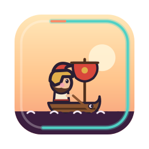
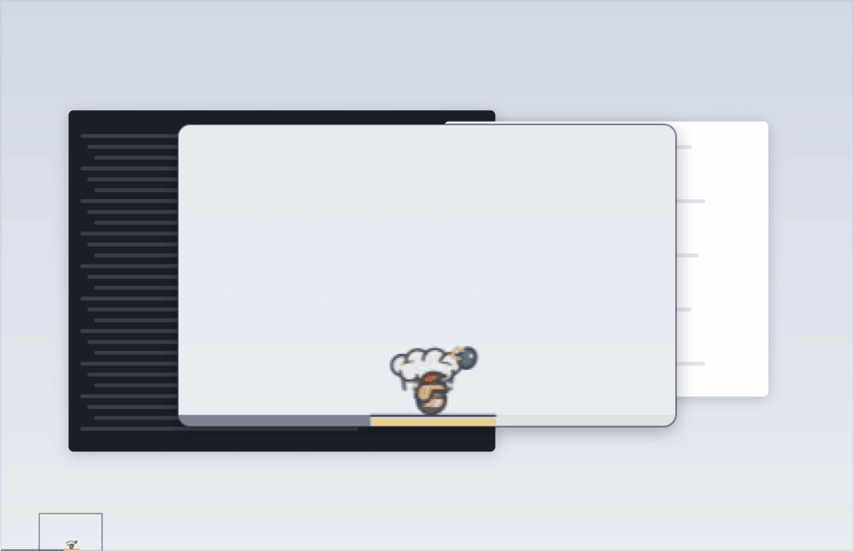
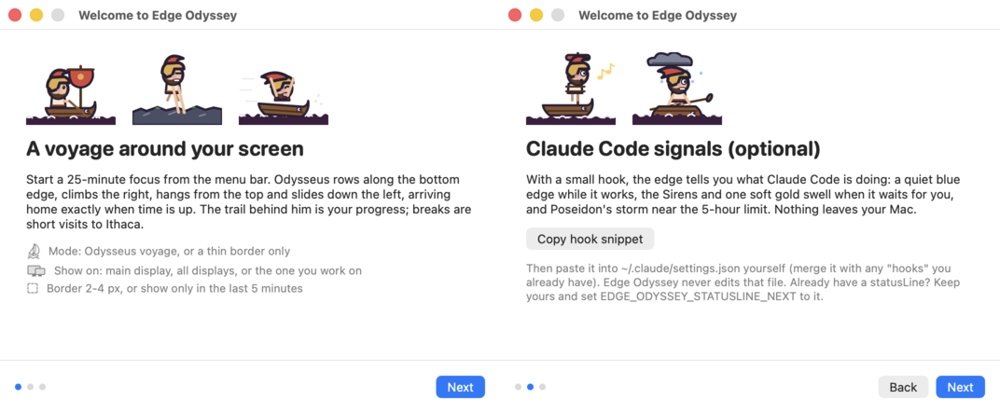
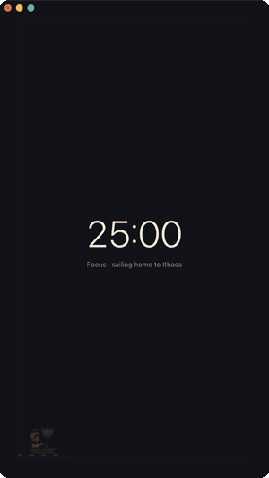
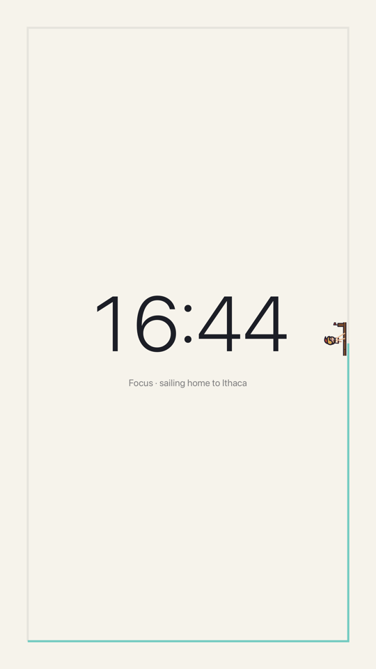
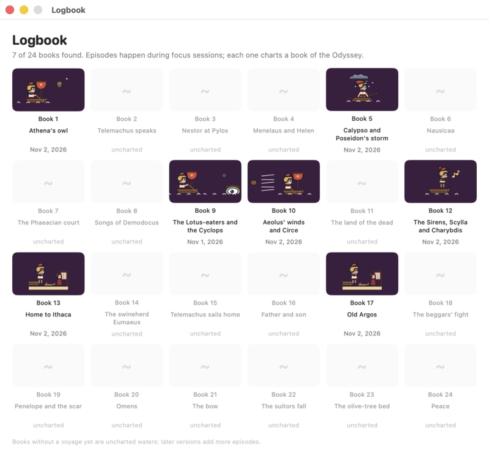

<p align="center"></p>

# Edge Odyssey

Mac 화면 가장자리에 사는 얇은 집중 타이머입니다. 클릭을 막지 않습니다. 집중 시간이 흐르는 동안
오디세우스가 아래 가장자리에서 노를 젓고, 오른쪽 벽을 오르고, 위쪽에 매달려 가다가 왼쪽으로
미끄러져 내려옵니다. Claude Code가 나를 부르면 가장자리가 은은하게 빛납니다.

[English README](README.md)

<p align="center"></p>
<p align="center"><sub>25분 한 바퀴를 75배속으로, 카메라가 오디세우스를 따라갑니다.</sub></p>

- **가장자리 뽀모도로.** 집중 25분, 휴식 5분, 네 번째 휴식은 깁니다. 오디세우스의 위치가 곧
  지난 시간이고(일정한 속도로 가므로 반 바퀴면 절반이 지난 것), 지나온 길이 진행 막대입니다.
  시간이 다 되는 순간 정확히 집에 도착합니다.
- **변마다 그럴듯한 몸짓.** 바닥에서는 노 젓기, 오른쪽은 붙잡고 당기며 오르기(절벽, 올리브 나무,
  돛대), 위쪽은 매달려 흔들리거나 짚라인, 왼쪽은 폭포 미끄럼, 착지할 때는 찌그러짐. 모양만
  달라지고 속도는 같습니다. *Mode > Speed: Physical*을 고르면 오르막은 느리고 미끄럼은 빨라져서
  위치가 더는 시간을 뜻하지 않습니다.
- **오디세이아 에피소드.** 키클롭스, 아이올로스의 바람 자루, 키르케의 새끼 돼지, 카리브디스,
  아테나의 부엉이가 바퀴마다 다르게 찾아오고, 24권짜리 항해 일지를 채웁니다.
- **Claude Code 신호(선택).** 일하는 중엔 조용한 파란 테두리, 나를 기다리면 세이렌과 금빛
  한 번, 5시간 사용 한도에 가까우면 포세이돈의 폭풍.
- **집중 모드.** 시간을 한가운데서 보고 싶을 때: Control-Option-Command-F로 차분한 전체 화면을
  엽니다. 가운데에 큰 남은 시간, 그 둘레에 시간이 지나며 차오르는 트랙, 그 위를 세 배 크기의
  오디세우스가 항해합니다. 보조 모니터나 세로 모니터에 잘 맞습니다.
- **방해하지 않음.** 2-4px 테두리, 클릭은 그대로 통과, 전체 화면 앱과 화면 공유·녹화 중에는
  숨고, Control-Option-Command-H로 언제든 숨깁니다.
- **매끄럽고 가벼움.** 움직임은 모두 macOS 렌더 서버에서 돌고, 앱은 모서리와 상태 변화 때만
  깨어납니다(CPU 약 0.1%).

## 설치

Edge Odyssey는 Apple silicon Mac의 macOS 13 이상에서 쓸 수 있습니다. [Releases
페이지](https://github.com/s3onghyun/edge-odyssey/releases)에서 최신
`Edge-Odyssey-<version>-arm64.zip`와 짝이 되는 `.sha256` 파일을 받으세요. 첫 공개 릴리스는
Apple silicon 전용이며, 아직 universal 빌드는 제공하지 않습니다.

설치하기 전에 내려받은 파일을 확인합니다.

```sh
cd ~/Downloads
shasum -a 256 -c Edge-Odyssey-<version>-arm64.zip.sha256
ditto -x -k "Edge-Odyssey-<version>-arm64.zip" .
mv "Edge Odyssey.app" /Applications/
```

앱은 ad-hoc 서명만 되어 있고 **아직 공증(notarization)을 받지 않았습니다**. 처음 실행할 때
응용 프로그램 폴더에서 **Edge Odyssey**를 Control-클릭해 **열기**를 고른 뒤 다시 **열기**를
누르세요. 그래도 차단되면 **시스템 설정 → 개인정보 보호 및 보안**에서 **그래도 열기**를
누르세요. 공증은 추후 릴리스에 추가할 예정입니다.

### 소스에서 빌드

직접 빌드하려면 Xcode Command Line Tools(`xcode-select --install`)만 있으면 됩니다. Xcode
프로젝트는 없습니다.

```sh
git clone <이 저장소> && cd edge-odyssey
./build.sh                                   # -> build/Edge Odyssey.app
cp -R "build/Edge Odyssey.app" /Applications/
open "/Applications/Edge Odyssey.app"
```

처음 실행하면 세 쪽짜리 환영 안내가 열립니다. 그다음부터는 메뉴 막대(점선 동그라미)에 있습니다.

<p align="center"></p>

## 메뉴

| 항목 | 하는 일 |
|---|---|
| 집중 시작 / 일시정지 / 재개 / 건너뛰기 / 정지 | 타이머. 메뉴 막대에 남은 시간을 초 단위로 표시(`12:50`) |
| Timer | 집중 15/25/45/50/90분 또는 직접 입력(1-240), 휴식 5/10/15분 또는 직접 입력(1-60), 2-6회마다 긴 휴식(15분), 시간이 다 됐을 때의 동작(아래). 바꾼 시간은 다음 세션부터 적용 |
| Focus mode | 어디서든 Control-Option-Command-F: 전체 화면 집중 모드(아래). 한 번 더 누르면 닫힘 |
| Focus mode on | 모니터가 둘 이상일 때 집중 모드를 열 모니터(기억됨) |
| Mode | 오디세우스 항해(테두리 + 여행자) 또는 얇은 테두리만. Speed: Even(기본) 또는 Physical |
| Show on | 주 모니터, 모든 모니터(오디세우스는 작업 중인 모니터로 따라옴), 따라오기, 또는 이름으로 고른 모니터 |
| Border | 2, 3, 4px |
| Only show in the last 5 minutes | 집중의 마지막 5분 전까지 가장자리를 비워 둠(Claude Code 호출은 표시) |
| Logbook… | 모은 오디세이아 24권 |
| Settings | Claude Code 신호, 게임·영상·SNS 앱이 앞에 있으면 졸기, 화면 공유 중 숨기기, 초 단위 카운트다운(끄면 `13m`처럼 분 단위), **로그인 시 실행**(켜기 전까지 꺼짐), 환영 안내 |
| Hide now | 어디서든 Control-Option-Command-H |

설정은 다시 실행해도 유지됩니다.

### 시간이 다 되면

- **집중이 끝날 때:** 오디세우스가 정확히 제시간에 왼쪽 아래 모서리로 돌아와 이타카에
  닿습니다(긴 휴식이면 칼립소의 섬). 가장자리가 금색으로 한 번 빛나고, 테두리가 연보라로 바뀌며
  휴식 시간만큼 줄어듭니다. macOS 알림으로 "이타카! 5분 쉬어요"가 뜹니다(기본 켜짐, 처음 한 번
  권한을 묻습니다). *Timer > Sound* 를 켜면(기본 꺼짐) 도착할 때 짧은 하프 소리가 납니다.
  휴식은 저절로 시작됩니다.
- **휴식이 끝날 때:** 테두리가 사라지고 "쉬는 시간 끝" 알림이 뜬 뒤, 다음 집중은 메뉴에서
  **직접 시작할 때까지 기다립니다.** 저절로 시작하려면 *Timer > Start the next focus after a
  break* 를 켜세요. 소리를 켜 두면 다시 출항하라는 낮은 하프 소리가 납니다.
- *Timer > Sound*: **Harp**(이 앱을 위해 만든 짧은 두 소절), **Glass**(macOS 시스템 소리),
  **Off**(기본) 중에서 고르고, 음량은 low/medium 입니다. 고르면 한 번 들려줍니다.
- 알림은 macOS 집중 모드/방해 금지를 따르므로, 그동안은 뜨지 않습니다.

### 집중 모드

<p align="center">
  
  
</p>
<p align="center"><sub>세로 창에서 40배속으로 한 바퀴, 그리고 세로 모니터 전체 화면.</sub></p>

*집중 모드*(Control-Option-Command-F 또는 메뉴)는 지난번에 쓴 모니터, 없으면 지금 작업 중인
모니터에 전체 화면으로 열립니다. 남은 시간은 가운데에 큰 숫자로 나오고, 둘레의 트랙이 진행
막대입니다(청록, 끝 무렵엔 산호색, 휴식 중엔 연보라로 줄어듦). 세 배 크기의 오디세우스가 일정한
속도로 트랙을 돌기 때문에 반 바퀴가 곧 절반입니다. 에피소드와 이타카, 칼립소의 섬도 같은 크기로
나오고, Claude Code 신호(금빛 한 번, 세이렌, 폭풍)도 트랙에 그대로 보입니다.

- **키:** Space로 시작·일시정지·재개, S로 휴식으로 건너뛰기(휴식 중엔 휴식 끝), Esc로 나가기.
  포인터를 움직이면 시작/일시정지, 건너뛰기, 나가기 버튼이 나타납니다. 창이 앞에 있을 때 빈
  곳을 클릭해도 나갑니다.
- **어디에:** *Focus mode on* 에서 모니터를 고릅니다. 보통의 전체 화면 창이라 Spaces를 오가거나,
  전체 화면을 끄고 크기를 바꾸거나, 닫을 수 있습니다.
- 집중 모드가 열려 있는 동안 그 모니터의 가장자리 표시는 집중 모드가 대신합니다(다른 모니터의
  테두리는 그대로). 밝은/어두운 화면은 macOS를 따릅니다.
- 화면 공유·녹화 중(그리고 Control-Option-Command-H)에는 남은 시간과 트랙을 숨기고 빈 배경만
  보여 줍니다. 창 자체도 스크린샷과 녹화에서 빠집니다.

<p align="center"></p>

## Claude Code 신호

환영 안내(또는 Settings > Welcome guide)에서 **Copy hook snippet**을 누르면 작은 스크립트 두 개를
`~/.edge-odyssey/hooks/`에 넣고 설정 조각을 클립보드에 복사합니다. 그 조각은 직접
`~/.claude/settings.json`에 붙여 넣으세요. 이미 있는 `"hooks"`와는 합쳐야 합니다. Edge Odyssey는
그 파일을 절대 고치지 않습니다. 이미 `statusLine`을 쓰고 있다면 그대로 두고
`EDGE_ODYSSEY_STATUSLINE_NEXT`에 기존 명령을 넣으면 둘 다 동작합니다.

손으로 설치하고 싶다면 같은 파일이 [`hooks/`](hooks/)에 있습니다.

훅은 세션마다 `~/.edge-odyssey/sessions/`에 아주 작은 파일 하나(`working`, `waiting`, `limit`과
시각)를 쓰고, 상태 줄은 `~/.edge-odyssey/usage`를 씁니다. 앱은 폴더 변화를 감시합니다(폴링 없음).
아무것도 Mac 밖으로 나가지 않습니다.

| Claude Code 이벤트 | 가장자리 |
|---|---|
| UserPromptSubmit, PreToolUse, PostToolUse | 일하는 중: 조용한 파랑(타이머가 없을 때만) |
| Notification(권한, 대기, 질문, 입력 필요), Stop | 기다리는 중: 세이렌, 금빛 한 번 |
| StopFailure(rate_limit), 또는 5시간 사용량 85% 이상 | 한도 근접: 호박색, 포세이돈의 폭풍 |
| SessionEnd | 세션 제거 |

## 개인정보

네트워크 접속도, 분석 도구도 없습니다. 오버레이 창은 스크린샷과 화면 녹화에서 빠지고, macOS
화면 캡처 표시등이 켜져 있는 동안(Zoom, Meet, QuickTime 등)에는 가장자리 전체(와 집중 모드의
내용)가 숨습니다.
로컬 파일은 `~/.edge-odyssey/`(훅 상태, 항해 일지)와 앱 환경설정(`app.edgeodyssey`)뿐입니다.

## 명령줄

```sh
APP="/Applications/Edge Odyssey.app/Contents/MacOS/EdgeOdyssey"
"$APP" --speed 75 --autostart     # 시연: 25분을 20초에
"$APP" --ctl start|pause|resume|stop|skip|logbook|welcome|hide|show|quit
"$APP" --ctl focus-mode:on|off|toggle   # 또는 focus-display:<모니터 이름>
```

플래그(이번 실행에만 적용, 저장 안 됨): `--display main|all|follow|<번호>|<이름>`,
`--style border|traveler`, `--pace even|physical`, `--thickness 2..4`, `--last5`, `--focus <분>`, `--rest <분>`,
`--no-lotus`, `--char <id>`, `--state-dir <폴더>`, `-v`(stderr에 로그). 시연·테스트용:
`--focus-mode`(실행하며 열기), `--focus-frame x,y,w,h`(전체 화면 대신 창), `--appearance dark|light`.

## 개발

```sh
./build.sh      # Command Line Tools의 swiftc로 앱 빌드
./test.sh       # 움직임 수학 테스트(Swift Testing): 정확한 시각, 다시 걸어도 튀지 않음, 스프라이트 박자, 집중 모드 배치
```

| 경로 | 라이선스 | 내용 |
|---|---|---|
| `Sources/` | MIT | 앱(AppKit, SwiftUI 창, Core Animation) |
| `Tests/`, `Package.swift`, `test.sh` | MIT | 움직임 수학 테스트 |
| `hooks/` | MIT | Claude Code 훅과 상태 줄 스크립트, 설정 조각 |
| `tools/` | MIT | 그림 생성기(`make_odysseus.py`, `make_icon.py`), 시트 빌더, `svg2png.swift` |
| `assets/` | 모든 권리 보유, 개인 사용 허락: [`assets/LICENSE`](assets/LICENSE) | 캐릭터, 아이콘, 스크린샷, 스케치, 소리 |

코드는 MIT([`LICENSE`](LICENSE))입니다. 그림은 아닙니다. 이 저장소를 직접 빌드해 쓰는 것은
괜찮지만, 그림을 재배포하거나 파생 캐릭터를 만들 수는 없습니다. 포크는 자기 그림으로 환영합니다.
그림을 만든 과정은 [`PROVENANCE.md`](PROVENANCE.md)에 있습니다.

### 캐릭터 형식

캐릭터는 `.sprite` 텍스트 격자(픽셀 아트: 팔레트 + 프레임)이거나, `character.txt`와 SVG 프레임이
든 폴더(벡터)입니다. 앱이 찾는 애니메이션: `walk`(아래), `climb` / `climb-*`(오른쪽),
`cling` / `zip`(위), `slide`(왼쪽), `idle`, `sirens`, `storm`, `rest`, `ithaca`, `doze`, `ram`,
에피소드 소품 `ep-*`. 없는 것은 `walk`나 `idle`로 대신하므로 걷기 한 동작만으로도 새 캐릭터를
시작할 수 있습니다.

바뀐 내용은 [`CHANGELOG.md`](CHANGELOG.md)에 있습니다.
