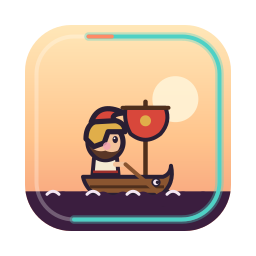
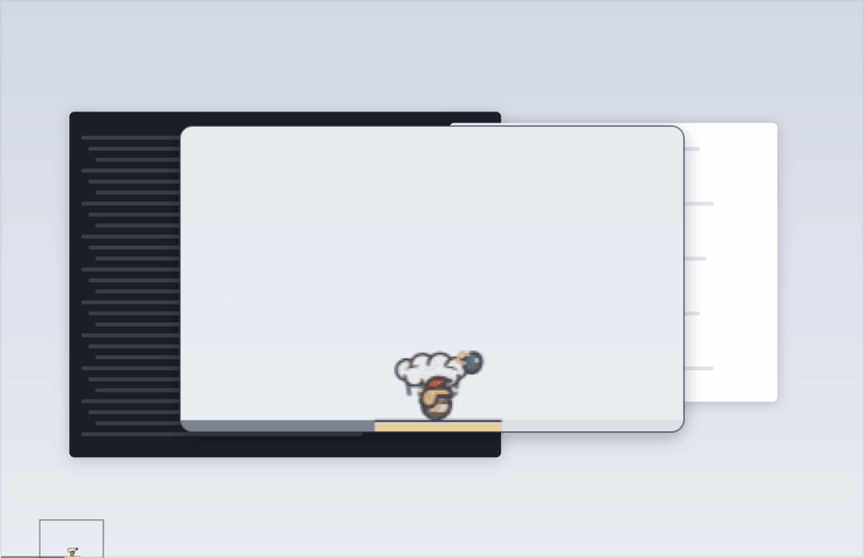
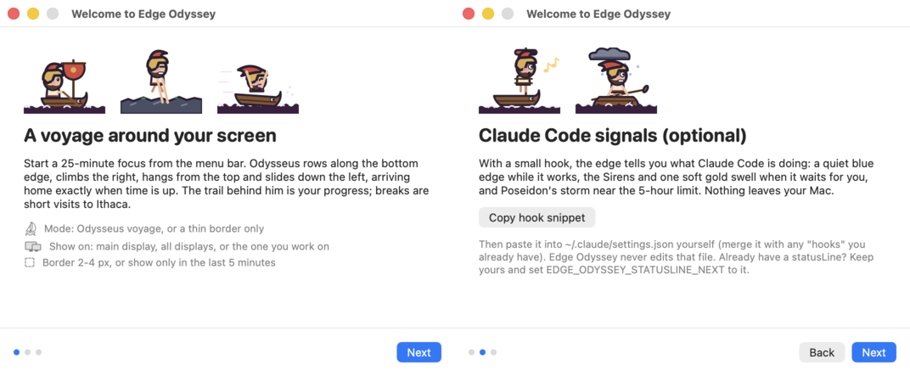
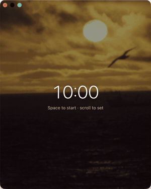
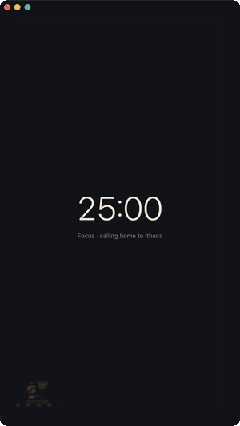
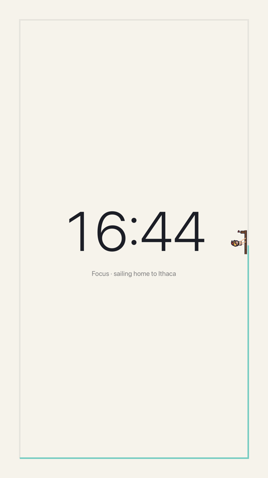
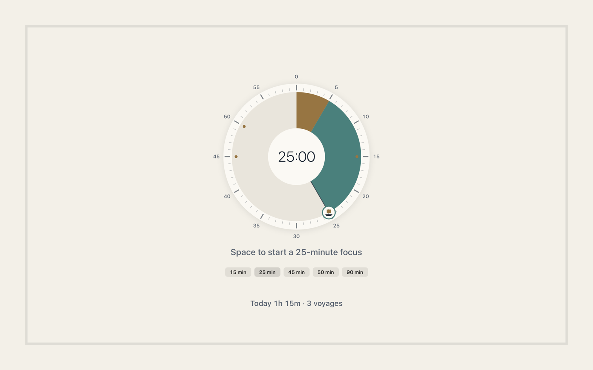
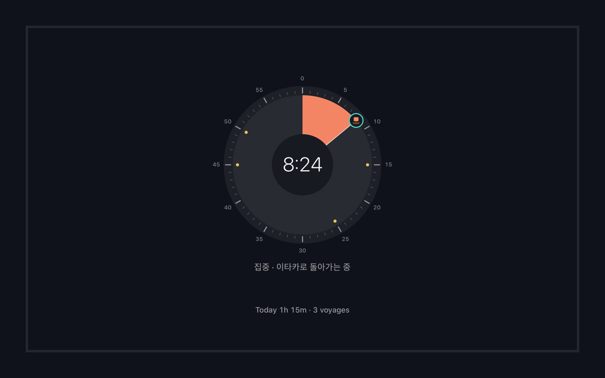
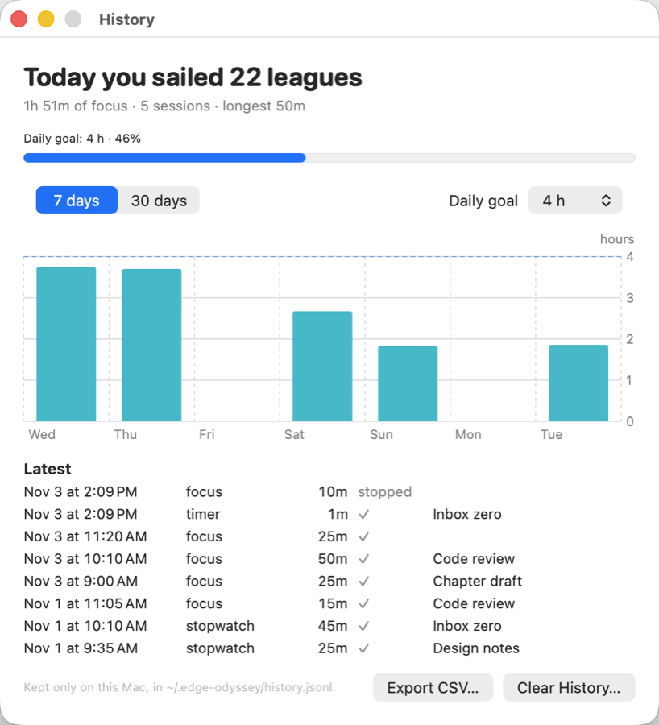
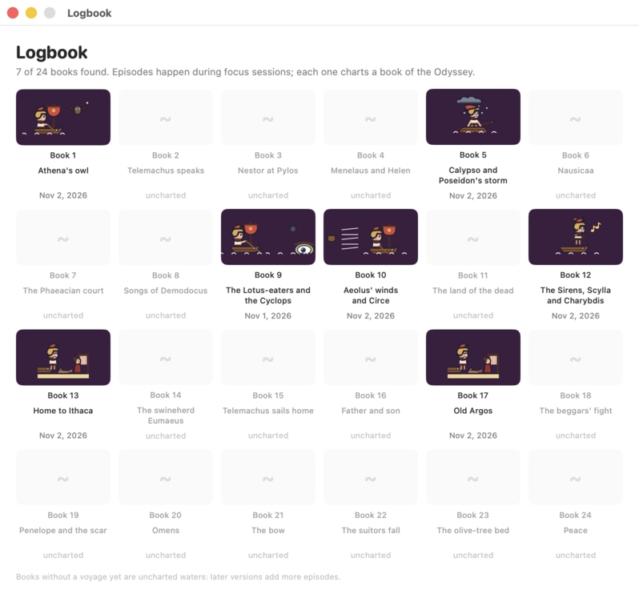

<p align="center"></p>

<h1 align="center">Edge Odyssey</h1>

<p align="center"><b>A pomodoro that lives on the edge of your screen.</b><br>
Odysseus rows along the bottom, climbs, hangs and slides round your Mac's screen edge as the
session passes, and the edge glows when Claude Code needs you.</p>

<p align="center">
  English · <a href="README.zh-CN.md">简体中文</a> · <a href="README.ja.md">日本語</a> · <a href="README.ko.md">한국어</a>
</p>

<p align="center">
  <a href="https://github.com/s3onghyun/edge-odyssey/releases/latest"></a>
  
  <a href="LICENSE"></a>
  
</p>

<p align="center"></p>
<p align="center"><sub>One 25-minute lap at 75x speed, recorded from the app's own windows: the whole screen, and a magnifier following Odysseus.</sub></p>

**Install** (macOS 13+, Apple silicon): download the ZIP from
[Releases](https://github.com/s3onghyun/edge-odyssey/releases/latest), unzip it and move
**Edge Odyssey** to Applications, or run `brew install --cask s3onghyun/tap/edge-odyssey`. It is not notarized yet, so the first launch needs one approval:
see [First launch](#first-launch). The app speaks English, 한국어, 日本語 and 简体中文
([Languages](#languages)).

- **Pomodoro on the edge.** 25 minutes of focus, 5 minutes of break, every fourth break is
  long. Where Odysseus is on the edge is how much of the session has passed (he moves at an
  even pace, so halfway round is halfway through); the trail behind him is the progress bar,
  and he arrives home exactly when time is up.
- **Physical on every edge.** Rowing on the floor, grip-and-pull climbing (cliffs, an olive
  tree, the mast), hanging and swaying from the top or riding a zipline, a gravity slide down
  a waterfall, a squash on landing. These are looks only; *Mode > Speed: Physical* also makes
  him slow on the climb and fast on the slide, so his place no longer reads as time.
- **Episodes from the Odyssey.** The Cyclops, Aeolus' bag of winds, Circe's piglets,
  Charybdis and Athena's owl visit different laps and fill a 24-book logbook.
- **Claude Code signals (optional).** Quiet blue edge while it works, the Sirens and one soft
  gold swell when it is waiting for you, Poseidon's storm near the 5-hour usage limit.
- **Focus mode.** When you want the time front and centre: Control-Option-Command-F opens a
  calm full-screen view with a Time-Timer-style dial (scroll it, drag it or click a preset), a
  track around it that fills as time passes,
  and Odysseus at three times the size sailing round it, over a dimmed public-domain photo of
  the sea, a coast, the Aegean from orbit or the night sky (or your own). Made for a second or vertical monitor.
- **Pomodoro, timer or stopwatch.** Besides focus-and-break sessions, a plain countdown of any
  length (presets from 1 minute to an hour) and a stopwatch. Scroll over the time to change it:
  a minute per notch, Shift for five, Option for ten seconds.
- **Focus history.** Every focus, timer and stopwatch run is kept on your Mac: today's total
  in the menu and in focus mode ("today you sailed 22 leagues"), a 7- or 30-day chart against a
  daily goal, CSV export.
- **Out of your way.** A 2-4 px border, never takes a click, hides in full-screen apps and
  while the screen is shared or recorded, and on Control-Option-Command-H.
- **Smooth and light.** All motion runs in the macOS render server; the app wakes only at
  corners and state changes (about 0.1% CPU).

## Install

Edge Odyssey needs macOS 13 or later on an Apple-silicon or Intel Mac. Download the current
`Edge-Odyssey-<version>-arm64.zip` and its matching `.sha256` file from the
[latest release](https://github.com/s3onghyun/edge-odyssey/releases/latest). The filename stays
the same for Homebrew compatibility; the app inside is a universal build for both kinds of Mac.

Verify the download before installing:

```sh
cd ~/Downloads
shasum -a 256 -c Edge-Odyssey-<version>-arm64.zip.sha256
ditto -x -k "Edge-Odyssey-<version>-arm64.zip" .
mv "Edge Odyssey.app" /Applications/
```

### Homebrew

```sh
brew install --cask s3onghyun/tap/edge-odyssey
```

`brew upgrade --cask edge-odyssey` updates it. The first launch still needs one approval (below).
Homebrew 7 and later load casks from other taps only once you trust them; installing by the full
name, as above, trusts this one cask by itself. To look at it first with
`brew info --cask s3onghyun/tap/edge-odyssey`, run `brew trust --cask s3onghyun/tap/edge-odyssey` before it.

## Control from anywhere

Start, pause or finish a voyage without finding the menu bar: Edge Odyssey accepts control URLs,
so the same action works from your launcher, Shortcuts, Git hooks, or Claude Code. Copy
`scripts/edge-odyssey` somewhere on your `PATH` (for example, `cp scripts/edge-odyssey ~/bin/`),
then make it executable with `chmod +x ~/bin/edge-odyssey`.

```sh
# Raycast or Alfred: use this as a Script Command.
edge-odyssey 'start?minutes=50&label=fix-auth'

# Shortcuts: add an “Open URLs” action with this URL.
edge-odyssey://pause

# .git/hooks/post-checkout (then: chmod +x .git/hooks/post-checkout)
edge-odyssey 'start?minutes=25&label=checkout'

# A Claude Code /focus slash command can run this shell command.
edge-odyssey 'start?minutes=50&label=focus'
```

The built-in commands are `start` (optional `minutes` from 1–240 and `label`), `pause`, `resume`,
`stop` (or `finish`), `rest`, `extend`, `skip`, `hide`, `show`, `focus-mode`, `settings`,
`logbook`, and `history`. Invalid URLs are ignored safely.

### First launch

The app is ad-hoc signed but **not notarized yet**, so macOS asks once:

1. Open **Edge Odyssey** from Applications. macOS says it cannot verify the app; click **Done**.
2. Open **System Settings → Privacy & Security**, scroll down, click **Open Anyway** next to
   Edge Odyssey and confirm with Touch ID or your password.
3. On macOS 13-14 you can instead Control-click the app in Applications and choose **Open**
   (macOS 15 and later no longer offer this).

Prefer to check the code first? Build it yourself (below). Notarization will be added in a later
release.

### Build from source

To build your own copy, install the Xcode Command Line Tools (`xcode-select --install`); no
Xcode project is required.

```sh
git clone https://github.com/s3onghyun/edge-odyssey.git && cd edge-odyssey
./build.sh                                   # -> build/Edge Odyssey.app
cp -R "build/Edge Odyssey.app" /Applications/
open "/Applications/Edge Odyssey.app"
```

The first launch opens a three-page welcome guide. After that, Edge Odyssey lives in the
menu bar (the dashed circle; while a clock runs, a small ring that fills during a focus, turns
brass in its last five minutes and empties during a break).

<p align="center"></p>

## Menu

| Item | What it does |
|---|---|
| Start focus / Pause / Resume / Skip / Stop | The timer. The menu bar counts down to the second (`12:50`); scroll over it to change the time (below). After a focus: *Start break*, *5 more minutes* or *Stop* (below) |
| Timer | **Pomodoro**, **Countdown timer** or **Stopwatch** (below); the countdown's length (1, 3, 5, 10, 15, 30, 60 min or custom); focus 15/25/45/50/90 min or custom (1-240), break 5/10/15 min or custom (1-60), a long break (15 min) every 2-6 sessions, and what happens when time is up (below). Set an optional daily session goal (none, 4, 6, 8 or custom 1-24): completed focuses show `n/N` in the menu/focus footer, reset at local midnight (or *Reset today's count*), and reaching it sends a notification and stops auto-starting the next focus. A new length applies from the next session |
| Focus mode | Control-Option-Command-F, from anywhere: the full-screen focus view (below). Again to close |
| Focus mode on | With more than one display: which one focus mode opens on (remembered) |
| Focus mode background | Off, a different photo each session (default), one photo, or **your own folder**; slow drift on or off |
| Mode | Odysseus voyage (border + traveler) or a thin border only; Speed: Even (default) or Physical |
| Character | Odysseus (default) or the Developer voyager: a present-day coder with headphones and a laptop, sailing a dinghy over a terminal sea round every edge. The Odyssey's encounters (the Cyclops, the bag of winds, …) are Odysseus's only |
| Show on | Main display, all displays (Odysseus follows the display you work on), follow me, or one named display |
| Border | 2, 3 or 4 px |
| Only show in the last 5 minutes | Keeps the edge empty until the end of a focus session (Claude Code calls still show) |
| History… | Today's focus, a 7/30-day chart against your daily goal, the latest runs, CSV export, clear (below). The line under the menu header shows today's total |
| Label this session… | A one-line note kept with the run in the history (before starting: for the next one) |
| Logbook… | The 24 books of the Odyssey you have collected |
| Settings… (⌘,) | A window with every option of this menu, grouped (Timer, When time is up, On screen, Focus mode, General). It stays open, so you can change several in a row; each change applies at once |
| General | **Language** (below), Claude Code signals, doze while a game/video/social app is in front, hide while sharing, count down in seconds (turn off for whole minutes, `13m`), **Check for updates once a day** and *Check now* (below), **Launch at login** (off until you turn it on), Welcome guide |
| Hide now | Control-Option-Command-H, from anywhere |

Settings are remembered between launches.

### Languages

*Settings › Language*: System (the default), English, 한국어, 日本語 or 简体中文. The change applies at
once, in the menu, the open windows, focus mode and notifications, with no restart. *System* picks
the first of your preferred languages (System Settings › General › Language & Region) that the app
has, so `Français, 한국어` gives Korean; Traditional Chinese is not shown Simplified, it falls through
to your next language. Edge Odyssey also appears under *Language & Region › Applications* for a
per-app choice. Dates, weekdays and durations follow the chosen language (`2h 15m`, `2시간 15분`,
`2時間15分`, `2小时15分`).

The Japanese and Chinese texts are AI-assisted translations; corrections are welcome. Every string
is one `L.t(en, ko, ja, zh)` call, and `./test.sh` fails on a missing, empty or wrong-script
translation or an English string handed straight to the UI.

- 日本語: メニューの「設定 › 言語」で日本語を選ぶと、再起動なしですぐに切り替わります。訳は AI の補助によるもので、修正の提案を歓迎します。
- 简体中文：在菜单“设置 › 语言”中选择简体中文，无需重启即可切换。译文由 AI 辅助完成，欢迎指正。

### Updates

Once a day the app asks GitHub for the latest release: one HTTPS GET to
`api.github.com/repos/s3onghyun/edge-odyssey/releases/latest`, with only
`User-Agent: EdgeOdyssey/<version>`, `Accept` and a fixed `Accept-Language: en`, no cookies and no
cache. A failed check waits for the next day. When a newer version is out, the top of the menu shows
**Edge Odyssey <version> is out: release page…** and **Skip this version**, and you get one
notification for that version. The app never downloads or installs anything itself: download the
new ZIP from the release page, check its `.sha256` and replace the app as in [Install](#install).
*Settings › Check for updates once a day* turns it off; *Check now* asks at once.

### When time is up

- **End of a focus session:** Odysseus arrives home at the bottom-left corner exactly on time and
  lands on Ithaca (or on Calypso's island for a long break). A laurel-gold wave runs twice round
  the edge and ripples and sparkles spread from the harbor; the border then **stays gold, and the
  menu bar shows a gold `⚓ Arrived +0:42` that counts the time since**, until you choose. Click
  it: the menu opens with one line on what happened and, in large type, *☕ Start break* (the
  clock stops; Space in focus mode), *+5 min more focus* (S) or *Finish*. The first arrival also
  shows a one-time bubble under the badge saying the same. If you don't answer, the break starts
  by itself after 3 minutes (*Timer > If I don't answer at Ithaca*: 1, 3, 5 or 10 minutes, or keep
  waiting), and the overtime never runs past an hour: then the clock goes idle. A macOS
  notification says "Ithaca! Focus done. Start your 5-minute break to stop the clock (it starts by
  itself in 3 min).", with **Start break** and **+5 min** buttons (on by default; the first one
  asks for permission). A short harp phrase plays at low volume as he arrives (*Timer > Sound*).
  Turn on *Timer > Start the break by itself when a focus ends* for the old behaviour: the break
  starts at once.
- Gold has two meanings kept apart: laurel gold (`#E8C35A`) with the anchor is *you arrived*;
  the warmer gold swell is *Claude Code is waiting for you*.
- **End of a break:** the border goes away, a "Break's over" notification appears, and the
  timer **waits for you** to start the next focus from the menu. Turn on *Timer > Start the next
  focus after a break* if you want it to start by itself. With sound on, a low harp call says
  it's time to set sail again.
- *Timer > Sound*: **Harp** (default; two short phrases written for this app), **Glass** (the
  macOS system sound) or **Off**, and a low (default) or medium volume. Picking one plays it once;
  the welcome guide has the same switch and a *Listen* button. With the sound off, the
  notification brings the system alert sound instead (one sound, never two).
- *Timer > Dial sound*: a synthesized mechanical tick follows each one-minute dial adjustment;
  the 15, 25, 45 and 50-minute stops are a little heavier. It shares the end-sound volume and is
  on by default; turn it off here if you prefer silent dial changes.
- Notifications are time-sensitive and follow macOS Focus / Do Not Disturb: a Focus that doesn't
  allow them holds them back.

### Timer and stopwatch

<p align="center"></p>
<p align="center"><sub>A countdown set in steps (as with the scroll wheel), run at 40x speed in focus mode over a sunset photo.</sub></p>

*Timer* picks what the menu-bar and focus-mode clock is:

- **Pomodoro** (default): focus, then a break, a long break every few sessions.
- **Countdown timer**: one countdown of any length, 10 seconds to 24 hours: a preset, *Custom…*
  (`10` for minutes, `1:30`, `1:15:00`) or scrolling. Odysseus sails round once over its length.
  At 0:00 the edge glows gold, the sound and notification come as at the end of a focus, he
  rests a moment on Ithaca, and the timer is ready for the next run. No break follows.
- **Stopwatch**: counts up from 0:00 until you stop it. Odysseus sails one lap of the edge per
  hour and starts the next; the trail stays teal, since nothing is running out.

Switching mode stops what is running. **Changing the time:** scroll over the time in the menu
bar or anywhere in focus mode (mouse wheel or trackpad; up adds, down takes away), or press the
arrow keys in focus mode (Up/Right add, Down/Left take away). One step is a minute, **Shift**
five minutes, **Option** ten seconds. In focus mode you can also drag round the dial, click a
point on it, or click a preset under it. When nothing runs it sets the next session's length
(Pomodoro focus lengths stay whole minutes) and is remembered; while one runs it moves what is
left of that session only. The dial clicks into 15, 25, 45 and 50 minutes: the wheel holds there
for two notches, a drag snaps to them, and a Force Touch trackpad gives a tap.

### Focus mode

<p align="center">
  
  
</p>
<p align="center"><sub>One lap at 40x speed in a vertical window, and full screen on a vertical display.</sub></p>
<p align="center">
  
  
</p>
<p align="center"><sub>The dial, rendered offscreen from the app's own views.</sub></p>

*Focus mode* (Control-Option-Command-F, or the menu) opens a full-screen view on the display
you last used for it, or the one you are working on. The middle is a dial with a 60-minute face,
read clockwise from twelve: the wedge is the time left (sea teal; the session's last fifth brass, so
the wedge turns brass as the end nears; slate during a break), with the countdown in its hub.
A sailboat marks the wedge's edge; drag it round or click the face to set the time, or pick a
preset under the dial while nothing runs. Longer than an hour fills the face. The stopwatch keeps
the large digits. VoiceOver reads the dial as an adjustable slider. The track around it all is the progress bar (teal, coral near the end, lavender
draining during a break), and a 3x Odysseus voyages round it at an even pace, so halfway round
is halfway through. Episodes, Ithaca and Calypso's island play at the same size, and Claude
Code signals still show on the track (the gold swell, the Sirens, the storm).

- **Keys:** Space starts, pauses or resumes; S skips to the break (or ends it); Esc exits;
  arrows, scrolling or the dial change the time (above).
  Moving the pointer shows Start/Pause, Skip and Exit buttons. Once the window is in front, a
  click on the background also exits.
- **Where:** *Focus mode on* picks the display. It is an ordinary full-screen window, so you
  can switch Spaces, leave full screen and resize it, or close it.
- While focus mode is open it replaces the edge on its display (other displays keep their
  border); the light or dark look follows macOS.
- **Background:** a photo of rough seas, a rocky coast, the Aegean from orbit, a sunset or the night sky behind the
  voyage, softened and dimmed so the time stays readable, with a slow drift. *Focus mode
  background* turns it off, keeps one, or uses **your own folder** of JPEG, PNG or HEIC photos
  (read on your Mac only). The seven photos that ship with the app are public domain (works of
  NASA, NOAA and the National Park Service); where each comes from is in
  [`assets/backgrounds/PROVENANCE.md`](assets/backgrounds/PROVENANCE.md).
- While the screen is shared or recorded (and on Control-Option-Command-H) the countdown, track
  and photo are hidden and only the plain background shows; the window is also left out of
  screenshots and recordings.

### Focus history

<p align="center"></p>
<p align="center"><sub>The history window (sample data).</sub></p>

Each focus session, countdown timer and stopwatch run is recorded when it ends: start, end,
mode, time on the clock (pauses left out), whether it ran to the end, and an optional one-line
label (*Label this session…*). A run stopped in its first minute is left out; breaks are not
recorded.

- **Today:** total time, sessions and the longest run, under the menu header and at the foot
  of focus mode, with the voyage in leagues (twelve an hour at the oar) and the daily goal.
- **History…** (Command-Y in the menu): a 7- or 30-day bar chart against the daily goal (none,
  1-8 hours; 4 by default), the latest runs, **Export CSV…** and **Clear History…**.
- A run that crosses midnight is split between the two days by wall time; days follow your
  Mac's time zone.
- Stored only on this Mac in `~/.edge-odyssey/history.jsonl` (one JSON line per run). Nothing is
  sent anywhere. Clearing it does not touch the logbook.

<p align="center"></p>

## Claude Code signals

In the welcome guide (or Settings > Welcome guide), **Copy hook snippet** puts two small
scripts in `~/.edge-odyssey/hooks/` and copies a settings snippet to the clipboard. Paste it
into `~/.claude/settings.json` yourself, merged with any `"hooks"` you already have. Edge
Odyssey never edits that file. If you already have a `statusLine`, keep it and set
`EDGE_ODYSSEY_STATUSLINE_NEXT` to your old command so both keep working.

The same files are in [`hooks/`](hooks/) if you prefer to install them by hand.

The hooks write one tiny file per session to `~/.edge-odyssey/sessions/` (`working`,
`waiting` or `limit` plus a timestamp); the status line writes `~/.edge-odyssey/usage`. The app
watches the folder (no polling). Nothing leaves your Mac.

| Claude Code event | Edge |
|---|---|
| UserPromptSubmit, PreToolUse, PostToolUse | working: quiet blue (only when no timer runs) |
| Notification (permission, idle, elicitation, agent needs input), Stop | waiting: the Sirens, one gold swell |
| StopFailure (rate_limit), or 5-hour usage >= 85% | limit: amber, Poseidon's storm |
| SessionEnd | session removed |

## Privacy

No analytics and no telemetry. The only network access is the once-a-day update check
([Updates](#updates)), which you can turn off. The overlay windows are excluded from screenshots and
screen recordings, and the whole edge (and focus mode's content) hides while the macOS screen-capture indicator is on
(Zoom, Meet, QuickTime and so on). Local files: `~/.edge-odyssey/` (hook states, logbook, focus history) and
the app's preferences (`app.edgeodyssey`).

## Command line

```sh
APP="/Applications/Edge Odyssey.app/Contents/MacOS/EdgeOdyssey"
"$APP" --speed 75 --autostart     # demo: 25 minutes in 20 seconds
"$APP" --ctl start|pause|resume|stop|skip|logbook|welcome|hide|show|quit
"$APP" --ctl focus-mode:on|off|toggle   # or focus-display:<display name>
"$APP" --ctl mode:pomodoro|timer|stopwatch
"$APP" --ctl timer:10|1:30|1:00:00       # countdown length (switches to the timer)
"$APP" --ctl adjust:60|-300              # like scrolling: seconds to add or take away
"$APP" --ctl history|label:<text>|goal:<hours>|clear-history
"$APP" --ctl background:off|cycle|<file name>   # or background-folder:<path>, drift:on|off
"$APP" --ctl language:auto|en|ko|ja|zh
"$APP" --ctl update-check|updates:on|off|release-page|skip-update
```

Flags (one run only, not saved): `--display main|all|follow|<index>|<name>`, `--style border|traveler`, `--pace even|physical`,
`--thickness 2..4`, `--last5`, `--focus <min>`, `--rest <min>`, `--mode pomodoro|timer|stopwatch`,
`--timer <length>`, `--background off|cycle|<file name>`, `--no-lotus`, `--char <id>`,
`--state-dir <dir>`, `--lang en|ko|ja|zh|auto`, `-v` (log to stderr). For demos and tests: `--focus-mode` (open it at launch),
`--focus-frame x,y,w,h` (a window instead of full screen), `--appearance dark|light`,
`--lang pseudo` (every string about 40% longer and accented, to find truncation),
`--capture-visible` (let screenshots include the edge and focus mode).

## Development

```sh
./build.sh      # the app, with swiftc from the Command Line Tools
./test.sh       # Swift Testing: exact timing, no jumps on re-apply, sprite timing, focus-mode layout, timer modes and time adjustment, history totals, every translation, update-notice rules
```

| Path | License | What |
|---|---|---|
| `Sources/` | MIT | The app (AppKit, SwiftUI windows, Core Animation) |
| `Tests/`, `Package.swift`, `test.sh` | MIT | Motion-math tests |
| `hooks/` | MIT | Claude Code hook and status-line scripts, settings snippet |
| `tools/` | MIT | Art generators (`make_odysseus.py`, `make_icon.py`, `make_social.py`), sheet builder, `svg2png.swift` |
| `assets/` | All rights reserved, personal-use grant: [`assets/LICENSE`](assets/LICENSE) | Characters, icon, screenshots, sketches, sounds |
| `docs/` | As `assets/` (it draws the character): [`assets/LICENSE`](assets/LICENSE) | Social preview card, made by `tools/make_social.py`; recordings of the app in `docs/media/` |
| `assets/backgrounds/` | Public domain (US government works): [`PROVENANCE.md`](assets/backgrounds/PROVENANCE.md) | Focus mode photos |

The code is MIT ([`LICENSE`](LICENSE)): `Sources/`, `Tests/`, `tools/`, `hooks/`, `build.sh`,
`test.sh` and `Package.swift`. The MIT license does not cover the character art, sprites and other
files under `assets/`, which have their own license ([`assets/LICENSE`](assets/LICENSE)): you may
use them in your own builds of this repository, but not redistribute them or make derivative
characters. Forks are welcome with their own art. See [`PROVENANCE.md`](PROVENANCE.md) for how the
art was made, and [`CONTRIBUTING.md`](CONTRIBUTING.md) to help.

### Character format

A character is either a `.sprite` text grid (pixel art: palette + frames) or a folder with
`character.txt` and SVG frames (vector). Animations the app looks for: `walk` (bottom edge),
`climb` / `climb-*` (right edge), `cling` / `zip` (top edge), `slide` (left edge), `idle`,
`sirens`, `storm`, `rest`, `ithaca`, `doze`, `ram`, and episode props `ep-*`. Missing ones fall
back to `walk` or `idle`, so a new character can start with a single walk cycle.
A character with no edge animations (`climb`, `cling`, `zip`, `slide`) sails every edge on its
`walk` cycle and turns the whole boat at the corners; one with no `ep-*` props has no Odyssey
episodes. The developer voyager (`tools/make_dev_voyager.py`) is both.

See [`CHANGELOG.md`](CHANGELOG.md) for what changed.
