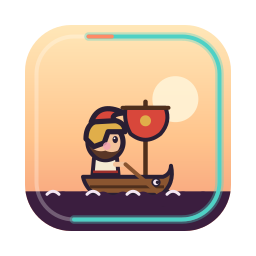
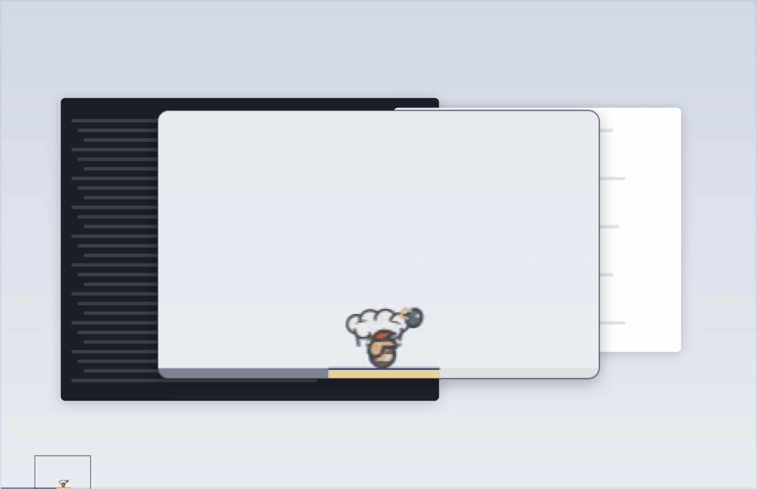
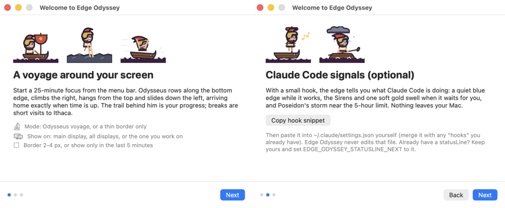
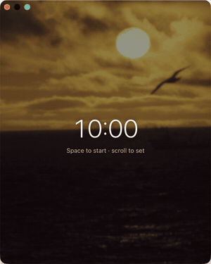
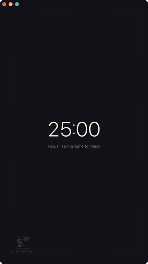
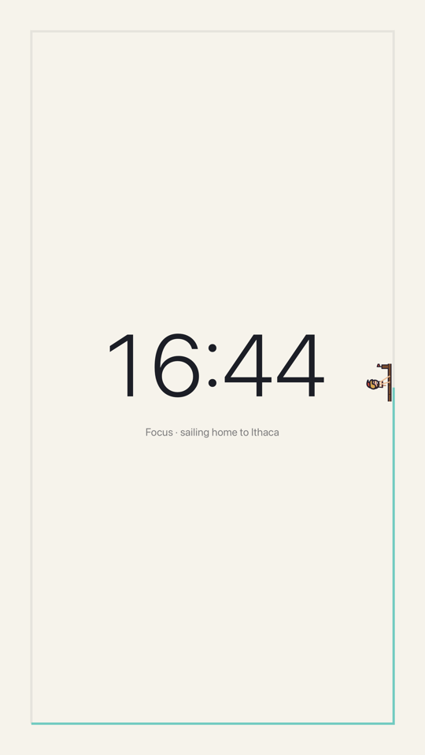
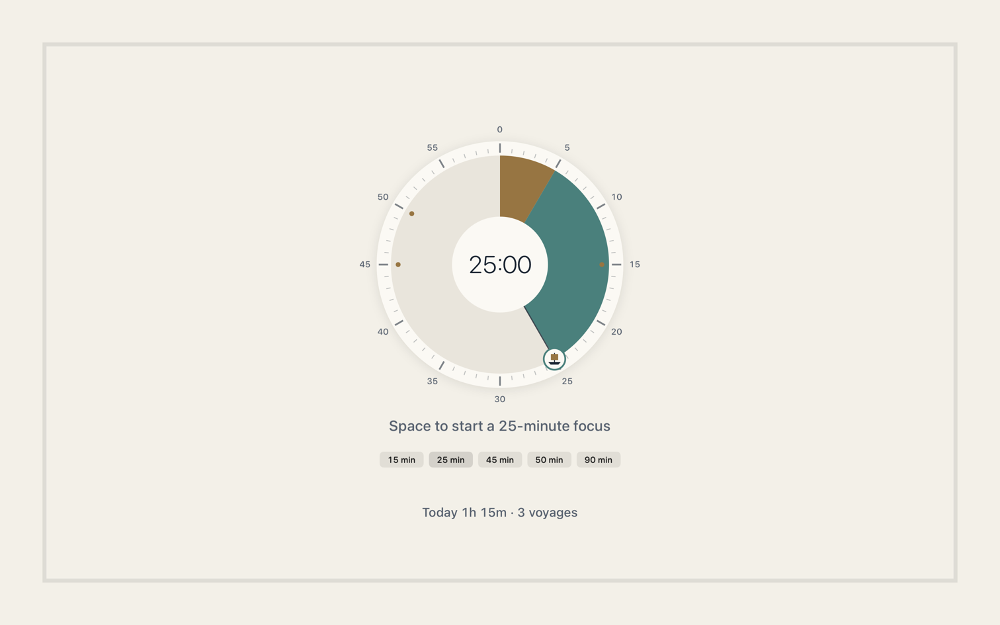
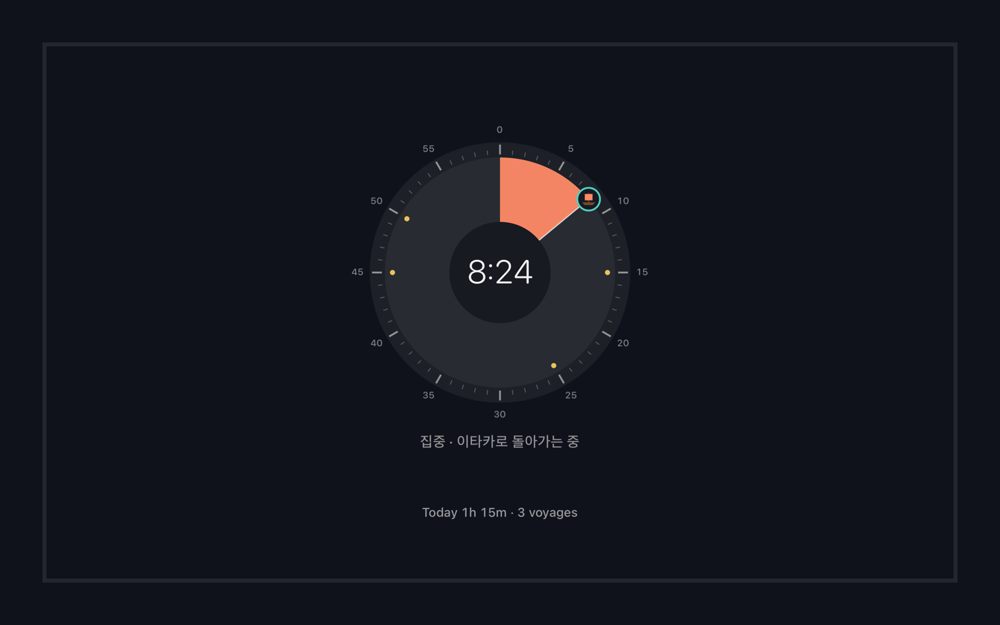
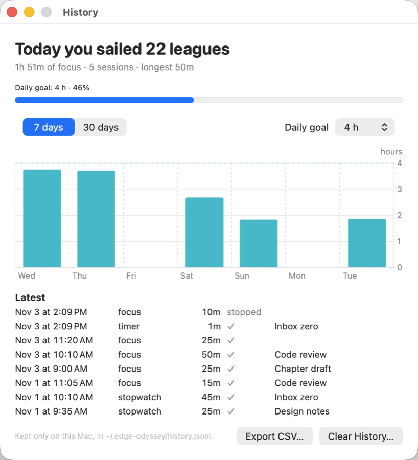
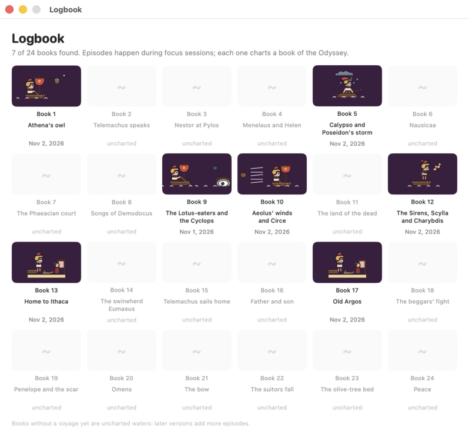

<p align="center"></p>

<h1 align="center">Edge Odyssey 边缘奥德赛</h1>

<p align="center"><b>住在屏幕边缘的番茄钟。</b><br>
专注计时开始后，小小的奥德修斯沿着 Mac 屏幕边缘划船、攀爬、悬挂、滑下，走完一圈正好时间到；
Claude Code 需要你时，屏幕边缘会轻轻发光。</p>

<p align="center">
  <a href="README.md">English</a> · 简体中文 · <a href="README.ja.md">日本語</a> · <a href="README.ko.md">한국어</a>
</p>

<p align="center">
  <a href="https://github.com/s3onghyun/edge-odyssey/releases/latest"></a>
  
  <a href="LICENSE"></a>
  
</p>

<p align="center"></p>
<p align="center"><sub>25 分钟的一圈以 75 倍速播放，只录制应用自己的窗口：整个屏幕，加上一个跟随奥德修斯的放大镜。</sub></p>

> 本文由 AI 辅助翻译，欢迎指正（[翻译反馈](https://github.com/s3onghyun/edge-odyssey/issues/new?template=translation.yml)）。项目本身由作者在 AI 编程助手协助下编写，美术也是用代码绘制的原创作品（见 [`PROVENANCE.md`](PROVENANCE.md)）。

**安装**（macOS 13 及以上，Apple 芯片）：从 [Releases](https://github.com/s3onghyun/edge-odyssey/releases/latest)
下载 ZIP，解压后把 **Edge Odyssey** 拖进“应用程序”，或者用 Homebrew：`brew install --cask s3onghyun/tap/edge-odyssey`。应用尚未经过公证，第一次打开需要允许一次：
见[首次打开](#首次打开)。界面支持简体中文、English、한국어、日本語，切换无需重启（[语言](#语言)）。

- **边缘上的番茄钟。** 专注 25 分钟，休息 5 分钟，每第四次休息是长休息。奥德修斯在边缘上的位置就是
  这一轮过去了多少（他匀速前进，走到一半就是过了一半）；他身后的航迹就是进度条，时间一到他正好到家。
- **每条边都有自己的动作。** 底边划船，右边抓握攀爬（悬崖、橄榄树、桅杆），顶边悬挂摆荡或滑索，
  左边顺着瀑布滑下，落地时还会压扁一下。这些只是外观；选择 *模式 › 速度：物理* 后，他会爬得慢、
  滑得快，位置就不再等于时间。
- **《奥德赛》里的插曲。** 独眼巨人、埃俄罗斯的风袋、喀耳刻的小猪、卡律布狄斯旋涡和雅典娜的猫头鹰
  会在不同的圈里出现，集满一本 24 卷的航海日志。
- **Claude Code 信号（可选）。** 它工作时边缘是安静的蓝色；等你回应时出现塞壬，并泛起一次柔和的金光；
  接近 5 小时用量上限时是波塞冬的风暴。
- **专注模式。** 想把时间放在正中间时：按 Control-Option-Command-F，打开一个安静的全屏界面。中间是
  Time Timer 式的表盘（滚动、拖动或点预设来设定），外圈的轨道随时间填满，三倍大的奥德修斯绕着它航行，
  背景是调暗的公有领域照片：大海、海岸、从轨道上看到的爱琴海或夜空（也可以用你自己的照片）。
  适合副屏或竖屏。
- **番茄钟、倒计时或秒表。** 除了专注与休息交替，还有任意长度的普通倒计时（预设 1 分钟到 1 小时）
  和秒表。在时间上滚动即可调整：每格 1 分钟，按住 Shift 为 5 分钟，Option 为 10 秒。
- **专注记录。** 每次专注、倒计时和秒表都记在你的 Mac 上：菜单和专注模式里显示今天的合计
  （“今天航行了 22 里格”），还有对照每日目标的 7 天 / 30 天图表，以及 CSV 导出。
- **不碍事。** 2–4 像素的细边框，从不拦截点击；全屏应用中、共享或录制屏幕时自动隐藏，
  按 Control-Option-Command-H 也能随时隐藏。
- **流畅而轻。** 所有动画都在 macOS 渲染服务器中运行，应用只在转角和状态变化时醒来（CPU 约 0.1%）。

## 安装

Edge Odyssey 需要 Apple 芯片的 Mac 和 macOS 13 或更高版本。从[最新版本](https://github.com/s3onghyun/edge-odyssey/releases/latest)
下载 `Edge-Odyssey-<version>-arm64.zip` 和对应的 `.sha256` 文件。（目前只提供 Apple 芯片版本，
还没有 universal 版本。）

安装前先校验下载的文件：

```sh
cd ~/Downloads
shasum -a 256 -c Edge-Odyssey-<version>-arm64.zip.sha256
ditto -x -k "Edge-Odyssey-<version>-arm64.zip" .
mv "Edge Odyssey.app" /Applications/
```

### Homebrew

```sh
brew install --cask s3onghyun/tap/edge-odyssey
```

用 `brew upgrade --cask edge-odyssey` 更新。首次打开时同样需要允许一次（见下文）。
Homebrew 7 起，其他 tap 里的 cask 要先信任（trust）才会加载。像上面那样用完整名称安装，会自动信任这一个 cask。想在安装前用 `brew info --cask s3onghyun/tap/edge-odyssey` 查看，请先运行 `brew trust --cask s3onghyun/tap/edge-odyssey`。

### 首次打开

应用使用 ad-hoc 签名，但**尚未经过公证**，所以 macOS 会询问一次：

1. 在“应用程序”中打开 **Edge Odyssey**。macOS 提示无法验证该应用时，点击 **完成**。
2. 打开 **系统设置 → 隐私与安全性**，向下滚动，点击 Edge Odyssey 旁边的 **仍要打开**，
   再用触控 ID 或密码确认。
3. 在 macOS 13–14 上，也可以在“应用程序”中按住 Control 点按应用，选择 **打开**
   （macOS 15 起不再提供这个方法）。

想先看代码？可以自己构建（见下）。以后的版本会加入公证。

### 从源码构建

只需要 Xcode Command Line Tools（`xcode-select --install`），不需要 Xcode 项目。

```sh
git clone https://github.com/s3onghyun/edge-odyssey.git && cd edge-odyssey
./build.sh                                   # -> build/Edge Odyssey.app
cp -R "build/Edge Odyssey.app" /Applications/
open "/Applications/Edge Odyssey.app"
```

第一次打开会显示三页欢迎指南。之后 Edge Odyssey 住在菜单栏里（一个虚线圆圈；计时进行时变成一个小圆环：
专注时逐渐填满，最后五分钟变成黄铜色，休息时逐渐变空）。

<p align="center"></p>

## 菜单

| 菜单项 | 作用 |
|---|---|
| 开始专注 / 暂停 / 继续 / 跳过 / 停止 | 计时器。菜单栏精确到秒倒数（`12:50`）；在上面滚动可调整时间（见下）。专注结束后：*开始休息*、*再专注 5 分钟* 或 *结束*（见下） |
| 计时器 | **番茄钟**、**倒计时** 或 **秒表**（见下）；倒计时长度（1、3、5、10、15、30、60 分钟或自定义）；专注 15/25/45/50/90 分钟或自定义（1–240），休息 5/10/15 分钟或自定义（1–60），每 2–6 轮一次长休息（15 分钟），以及时间到时怎么做（见下）。新的长度从下一轮开始生效 |
| 专注模式 | 在任何地方按 Control-Option-Command-F：全屏专注界面（见下）。再按一次关闭 |
| 专注模式显示在 | 有多个显示器时：专注模式在哪一个上打开（会记住） |
| 专注模式背景 | 关闭、每轮换一张照片（默认）、固定一张，或 **你自己的文件夹**；缓慢漂移开或关 |
| 模式 | 奥德修斯航行（边框 + 旅行者）或只有细边框；速度：匀速（默认）或物理 |
| 显示在 | 主显示器、所有显示器（奥德修斯跟着你正在用的显示器）、跟随我，或指定的某个显示器 |
| 边框 | 2、3 或 4 像素 |
| 只在最后 5 分钟显示 | 专注快结束前边缘保持空白（Claude Code 的呼叫仍会显示） |
| 记录… | 今天的专注、对照每日目标的 7/30 天图表、最近的记录、CSV 导出、清除（见下）。菜单标题下的一行显示今天的合计 |
| 为本次添加标签… | 一行备注，随这次记录一起保存（开始前设置：用于下一次） |
| 航海日志… | 你已收集的《奥德赛》24 卷 |
| 设置…（⌘,） | 一个汇集本菜单全部选项的窗口（计时、时间到时、屏幕显示、专注模式、通用）。窗口保持打开，可以连续修改多项，每项修改立即生效 |
| 通用 | **语言**（见下）、Claude Code 信号、游戏/视频/社交应用在前台时打盹、共享屏幕时隐藏、按秒倒数（关闭后显示整分钟，如 `13m`）、**每天检查一次更新** 和 *立即检查*（见下）、**登录时启动**（默认关闭）、欢迎指南 |
| 立即隐藏 | 在任何地方按 Control-Option-Command-H |

设置会在重新启动后保留。

### 语言

*设置 › 语言*：系统（默认）、English、한국어、日本語 或 简体中文。切换立即生效，菜单、已打开的窗口、
专注模式和通知都会变，无需重启。*系统* 会从你的首选语言（系统设置 › 通用 › 语言与地区）中挑出应用
支持的第一个，所以 `Français, 中文（简体）` 会得到简体中文；繁体中文不会显示成简体，而是继续看下一个语言。
Edge Odyssey 也出现在 *语言与地区 › 应用程序* 中，可以单独设置。日期、星期和时长跟随所选语言
（`2h 15m`、`2시간 15분`、`2時間15分`、`2小时15分`）。

日文和中文文本由 AI 辅助翻译，欢迎指正。应用里的每个字符串都是一个 `L.t(en, ko, ja, zh)` 调用；
如果某个翻译缺失、为空、用错了文字，或者英文字符串被直接交给界面，`./test.sh` 就会失败。

### 更新

应用每天向 GitHub 查询一次最新版本：一个 HTTPS GET 请求到
`api.github.com/repos/s3onghyun/edge-odyssey/releases/latest`，只带
`User-Agent: EdgeOdyssey/<version>`、`Accept` 和固定的 `Accept-Language: en`，不带 cookie，不用缓存。
查询失败就等到第二天。有新版本时，菜单顶部显示 **Edge Odyssey <version> 已发布：发布页面…** 和
**跳过此版本**，并为这个版本发一次通知。应用从不自己下载或安装任何东西：请从版本页面下载新的 ZIP，
校验 `.sha256`，再按[安装](#安装)替换应用。*设置 › 每天检查一次更新* 可以关闭它；*立即检查* 马上查询。

### 时间到了

- **专注结束时：** 奥德修斯正好准时回到左下角的家，登上伊萨卡（长休息时是卡吕普索的岛）。一道月桂金色的
  光波绕边缘跑两圈，港口处泛起涟漪和闪光；之后边框**保持金色，菜单栏显示金色的 `⚓ 已到达 +0:42`，
  记录到达后过去的时间**，直到你做出选择。点它会打开菜单：一行说明发生了什么，下面是大字的
  *☕ 开始休息*（时钟停下；专注模式里按空格）、*再专注 5 分钟*（S）或 *结束*。第一次到达时，
  徽章下方还会出现一次性提示，说明同样的内容。如果你没有回应，休息会在 3 分钟后自动开始
  （*计时器 › 到达后没有回应时*：1、3、5 或 10 分钟，或一直等），超时最多一小时，之后时钟回到空闲。
  macOS 通知写着“专注完成。开始 5 分钟休息，计时就会停止（3 分钟后自动开始）。”，
  带有 **开始休息** 和 **+5 分钟** 按钮（默认开启；第一次会请求权限）。他到达时会以低音量弹一小段竖琴
  （*计时器 › 声音*）。打开 *计时器 › 专注结束后自动开始休息* 可以回到旧的方式：休息立即开始。
- 金色有两种含义，彼此分开：带锚的月桂金（`#E8C35A`）表示*你到了*；更暖的金色涌光表示
  *Claude Code 在等你*。
- **休息结束时：** 边框消失，出现“休息结束”通知，计时器**等你**从菜单开始下一次专注。如果想让它自动开始，
  打开 *计时器 › 休息后自动开始下一次专注*。开着声音时，一声低沉的竖琴提醒你再次启航。
- *计时器 › 声音*：**竖琴**（默认；为这个应用写的两小段旋律）、**玻璃**（macOS 系统声音）或 **关闭**，
  以及低（默认）或中音量。选中时会播放一次；欢迎指南里也有同样的开关和 *试听* 按钮。声音关闭时，
  通知会带上系统提示音（只有一个声音，不会两个）。
- *计时器 › 表盘声音*：每调节一整分钟，都会播放代码合成的轻微机械声；15、25、45 和 50 分钟的
  停靠点声音稍重。它与结束提示共用音量，默认开启；想安静调节时可在这里关闭。
- 通知是“时间敏感”的，并遵循 macOS 的专注模式 / 勿扰模式：不允许它们的专注模式会把它们挡住。

### 倒计时和秒表

<p align="center"></p>
<p align="center"><sub>倒计时一步步设定（就像用滚轮），在专注模式中以 40 倍速运行，背景是日落照片。</sub></p>

*计时器* 决定菜单栏和专注模式里的时钟是什么：

- **番茄钟**（默认）：专注，然后休息，每几轮一次长休息。
- **倒计时**：任意长度的一次倒计时，10 秒到 24 小时：选预设、*自定义…*（`10` 表示分钟、`1:30`、
  `1:15:00`）或滚动设定。奥德修斯在这段时间里绕一圈。到 0:00 时边缘发出金光，声音和通知和专注结束时一样，
  他在伊萨卡稍作休息，然后计时器准备好下一次。之后没有休息。
- **秒表**：从 0:00 开始往上数，直到你停下。奥德修斯每小时绕边缘一圈，然后开始下一圈；航迹保持青绿色，
  因为没有什么在流逝。

切换模式会停止正在运行的计时。**调整时间：** 在菜单栏的时间上或专注模式的任何地方滚动（鼠标滚轮或触控板；
向上加，向下减），或在专注模式中按方向键（上/右加，下/左减）。每一步 1 分钟，**Shift** 5 分钟，
**Option** 10 秒。在专注模式中也可以绕表盘拖动、点表盘上的某一点，或点下方的预设。没有计时在运行时，
它设定下一轮的长度（番茄钟的专注长度保持整分钟）并会记住；有计时在运行时，它只改变这一轮剩下的时间。
表盘在 15、25、45 和 50 分钟处有卡位：滚轮在那里停两格，拖动会吸附过去，Force Touch 触控板会轻轻一震。

### 专注模式

<p align="center">
  
  
</p>
<p align="center"><sub>竖向窗口中以 40 倍速走一圈，以及竖屏上的全屏。</sub></p>
<p align="center">
  
  
</p>
<p align="center"><sub>表盘，用应用自己的视图在屏幕外渲染。</sub></p>

*专注模式*（Control-Option-Command-F 或菜单）会在你上次使用的显示器或你正在用的显示器上打开全屏界面。
中间是一个 60 分钟刻度的表盘，从十二点顺时针读：扇形是剩余时间（海青色；一轮的最后五分之一是黄铜色，
所以快结束时扇形会变成黄铜色；休息时是石板灰），中心显示倒计时。一艘小帆船标出扇形的边缘；拖动它或点击
表盘来设定时间，没有计时在运行时也可以点表盘下方的预设。超过一小时会填满整个表盘。秒表保留大号数字。
VoiceOver 会把表盘读作可调节的滑块。外圈的轨道是进度条（青绿色，接近结束时变珊瑚色，休息时薰衣草色
逐渐变空），三倍大的奥德修斯匀速绕着它航行，所以走到一半就是过了一半。插曲、伊萨卡和卡吕普索的岛也以
同样大小出现，Claude Code 信号依然显示在轨道上（金色涌光、塞壬、风暴）。

- **按键：** 空格开始、暂停或继续；S 跳到休息（或结束休息）；Esc 退出；方向键、滚动或表盘调整时间（见上）。
  移动指针会显示开始/暂停、跳过和退出按钮。窗口在前台时，点背景也会退出。
- **在哪里：** *专注模式显示在* 选择显示器。它是普通的全屏窗口，所以你可以切换空间、退出全屏并调整大小，
  或者关闭它。
- 专注模式打开时，它在所在的显示器上代替边框（其他显示器保留边框）；浅色或深色外观跟随 macOS。
- **背景：** 汹涌的大海、岩石海岸、从轨道上看到的爱琴海、日落或夜空的照片衬在航行后面，经过柔化和调暗，
  让时间保持清晰，并缓慢漂移。*专注模式背景* 可以关闭、固定一张，或使用 **你自己的文件夹**（JPEG、PNG 或
  HEIC 照片，只在你的 Mac 上读取）。随应用附带的七张照片属于公有领域（NASA、NOAA 和美国国家公园管理局的作品），
  每张的来源见 [`assets/backgrounds/PROVENANCE.md`](assets/backgrounds/PROVENANCE.md)。
- 共享或录制屏幕时（以及按 Control-Option-Command-H 时），倒计时、轨道和照片会隐藏，只显示纯色背景；
  窗口也不会出现在截图和录屏中。

### 专注记录

<p align="center"></p>
<p align="center"><sub>记录窗口（示例数据）。</sub></p>

每次专注、倒计时和秒表结束时都会记录：开始、结束、模式、时钟上的时间（不含暂停）、是否走完，以及可选的
一行标签（*为本次添加标签…*）。第一分钟内就停止的不记录；休息不记录。

- **今天：** 总时间、次数和最长的一次，显示在菜单标题下和专注模式底部，并换算成航程里格
  （划桨一小时十二里格）和每日目标。
- **记录…**（菜单中 Command-Y）：对照每日目标（无、1–8 小时；默认 4 小时）的 7 天或 30 天柱状图、
  最近的记录、**导出 CSV…** 和 **清除记录…**。
- 跨过午夜的记录按实际时间分到两天；日期跟随 Mac 的时区。
- 只保存在这台 Mac 的 `~/.edge-odyssey/history.jsonl` 里（每次一行 JSON），不会发送到任何地方。
  清除记录不会影响航海日志。

<p align="center"></p>

## Claude Code 信号

在欢迎指南（或 设置 › 欢迎指南）中，**复制钩子配置** 会把两个小脚本放进 `~/.edge-odyssey/hooks/`，并把一段
设置复制到剪贴板。请你自己把它粘贴到 `~/.claude/settings.json`，并与已有的 `"hooks"` 合并。Edge Odyssey
从不修改那个文件。如果你已经有 `statusLine`，保留它，并把 `EDGE_ODYSSEY_STATUSLINE_NEXT` 设为原来的命令，
两者就都能用。

同样的文件也在 [`hooks/`](hooks/) 里，你也可以手动安装。

钩子为每个会话在 `~/.edge-odyssey/sessions/` 写一个很小的文件（`working`、`waiting` 或 `limit` 加时间戳）；
状态栏写 `~/.edge-odyssey/usage`。应用监视这个文件夹（不轮询）。没有任何东西离开你的 Mac。

| Claude Code 事件 | 边缘 |
|---|---|
| UserPromptSubmit、PreToolUse、PostToolUse | 工作中：安静的蓝色（仅在没有计时运行时） |
| Notification（权限、空闲、提问、代理需要输入）、Stop | 等待中：塞壬，一次金色涌光 |
| StopFailure（rate_limit），或 5 小时用量 >= 85% | 上限：琥珀色，波塞冬的风暴 |
| SessionEnd | 移除该会话 |

## 隐私

没有统计，没有遥测。唯一的联网是每天一次的更新检查（[更新](#更新)），可以关闭。覆盖层窗口不会出现在截图和
录屏中，macOS 的屏幕录制指示灯亮着时（Zoom、Meet、QuickTime 等），整个边缘（以及专注模式的内容）都会隐藏。
本地文件：`~/.edge-odyssey/`（钩子状态、航海日志、专注记录）和应用的偏好设置（`app.edgeodyssey`）。

## 命令行

```sh
APP="/Applications/Edge Odyssey.app/Contents/MacOS/EdgeOdyssey"
"$APP" --speed 75 --autostart     # 演示：25 分钟变成 20 秒
"$APP" --ctl start|pause|resume|stop|skip|logbook|welcome|hide|show|quit
"$APP" --ctl focus-mode:on|off|toggle   # 或 focus-display:<显示器名称>
"$APP" --ctl mode:pomodoro|timer|stopwatch
"$APP" --ctl timer:10|1:30|1:00:00       # 倒计时长度（切换到倒计时）
"$APP" --ctl adjust:60|-300              # 和滚动一样：增加或减少的秒数
"$APP" --ctl history|label:<文字>|goal:<小时>|clear-history
"$APP" --ctl background:off|cycle|<文件名>   # 或 background-folder:<路径>、drift:on|off
"$APP" --ctl language:auto|en|ko|ja|zh
"$APP" --ctl update-check|updates:on|off|release-page|skip-update
```

参数（只对这一次运行有效，不保存）：`--display main|all|follow|<编号>|<名称>`、`--style border|traveler`、
`--pace even|physical`、`--thickness 2..4`、`--last5`、`--focus <分钟>`、`--rest <分钟>`、
`--mode pomodoro|timer|stopwatch`、`--timer <长度>`、`--background off|cycle|<文件名>`、`--no-lotus`、
`--char <id>`、`--state-dir <目录>`、`--lang en|ko|ja|zh|auto`、`-v`（日志输出到 stderr）。用于演示和测试：
`--focus-mode`（启动时打开）、`--focus-frame x,y,w,h`（用窗口代替全屏）、`--appearance dark|light`、
`--lang pseudo`（每个字符串加长约 40% 并带重音符号，用来找截断）、`--capture-visible`（让截图包含边缘和专注模式）。

## 开发

```sh
./build.sh      # 用 Command Line Tools 的 swiftc 构建应用
./test.sh       # Swift Testing：精确计时、重新应用时不跳动、精灵节奏、专注模式布局、计时模式和时间调整、记录合计、每一条翻译、更新提示规则
```

| 路径 | 许可 | 内容 |
|---|---|---|
| `Sources/` | MIT | 应用（AppKit、SwiftUI 窗口、Core Animation） |
| `Tests/`、`Package.swift`、`test.sh` | MIT | 动作数学测试 |
| `hooks/` | MIT | Claude Code 钩子和状态栏脚本、设置片段 |
| `tools/` | MIT | 绘图生成器（`make_odysseus.py`、`make_icon.py`、`make_social.py`）、图表生成、`svg2png.swift` |
| `assets/` | 保留所有权利，允许个人使用：[`assets/LICENSE`](assets/LICENSE) | 角色、图标、截图、草图、声音 |
| `docs/` | 同 `assets/`（画了角色）：[`assets/LICENSE`](assets/LICENSE) | 社交预览卡片，由 `tools/make_social.py` 生成 |
| `assets/backgrounds/` | 公有领域（美国政府作品）：[`PROVENANCE.md`](assets/backgrounds/PROVENANCE.md) | 专注模式照片 |

代码采用 MIT 许可（[`LICENSE`](LICENSE)）：`Sources/`、`Tests/`、`tools/`、`hooks/`、`build.sh`、
`test.sh` 和 `Package.swift`。MIT 许可不包括 `assets/` 下的角色美术、精灵和其他文件，它们有自己的许可
（[`assets/LICENSE`](assets/LICENSE)）：你可以在自己构建的本仓库中使用它们，但不能再分发，也不能制作衍生角色。
欢迎用自己的美术来 fork。美术的制作过程见 [`PROVENANCE.md`](PROVENANCE.md)，参与贡献见
[`CONTRIBUTING.md`](CONTRIBUTING.md)。

### 角色格式

角色可以是一个 `.sprite` 文本网格（像素画：调色板 + 帧），也可以是一个包含 `character.txt` 和 SVG 帧的文件夹
（矢量）。应用会寻找的动画：`walk`（底边）、`climb` / `climb-*`（右边）、`cling` / `zip`（顶边）、
`slide`（左边）、`idle`、`sirens`、`storm`、`rest`、`ithaca`、`doze`、`ram`，以及插曲道具 `ep-*`。
缺少的会退回到 `walk` 或 `idle`，所以新角色只要一个走路循环就能开始。

更新内容见 [`CHANGELOG.md`](CHANGELOG.md)（英文）。
